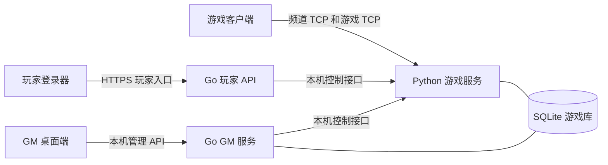

# 90USDFO 服务端源码

90USDFO 项目源码，包含游戏服务端、GM 管理后台、玩家登录器和组队中继。

[搭建与联网](#搭建与联网) · [服务端修改记录](#服务端修改记录)

| 目录 | 内容 |
| --- | --- |
| `server_proto/` | Python 服务端、协议处理、玩法逻辑、SQLite 迁移和测试 |
| `server_proto/native_core/` | 服务端原生计算模块 |
| `server_proto/pvf/native/` | PVF 原生读取模块 |
| `server_proto/start/native_launcher/` | 本地会话启动辅助程序 |
| `gm_manager/` | Go GM 服务、桌面端、玩家登录器及下载器 |
| `player_launcher/` | WPF 登录器、原生启动程序及辅助桥接 |
| `party_relay/` | Go 组队中继和边缘节点服务 |
| `server-pack-win10/` | Windows 运行目录和启动相关辅助源码 |

[GM 后台与登录器构建及本地配置](player_launcher/README.md)。

## 搭建与联网

以下以 Windows x64 同一台机器运行 Python 游戏服务和 Go 后台为例。先从本机连通，再改局域网或公网地址。PowerShell 示例中的地址、目录及端口按自己的环境填写。



### 1. 准备运行环境与配套文件

| 项目 | 所需内容 |
| --- | --- |
| 游戏服务器 | Windows x64、CPython **3.12.10 x64**、源码及匹配的原生 PVF 模块 |
| GM 后台与组队中继 | Go 1.26，按 [构建与本地配置](player_launcher/README.md) 编译。构建 WPF 登录器另需 .NET 8 SDK，运行时使用配套的 .NET 6.0.36 Windows x86。 |
| 游戏与大厅 | 自行准备同一版本的客户端、`DFO.exe`、服务端和玩家端各自配套的 `Script.pvf`、扩展和原生启动组件 |
| 游戏存档 | 自己的零玩家初始化 SQLite 库，或经备份和迁移核验的兼容库。Go 玩家服务需要账号、角色、钱包、GM 表及有效的钱包迁移记录。 |
| 玩家 HTTPS | 自己签发或取得的 **RSA 2048 位以上**证书与私钥。证书 SAN 匹配登录器填写的主机名或 IP。 |

公开库提供源码。完整启动还依赖游戏文件、初始化数据及配套保护构建输入。服务端首次启动自动建库会查找同版本分享版 `server-pack-win10/resources/` 下的 `schema_inventory_full.sql` 和 `default_inventory_seed.sql`，当前公开源码树仅附有迁移补丁。直接创建空 SQLite 文件无法满足 Go 玩家入口的库结构校验。应先准备兼容空库并在其副本上试装。

服务端 `usdof_pvf_native.cp312-win_amd64.pyd` 必须位于 `server_proto`。推荐同时构建同目录的 `usdof_core.cp312-win_amd64.pyd`。编译时按 [PVF 模块](server_proto/pvf/native/README.md) 和 [原生计算模块](server_proto/native_core/README.md) 准备 CPython 头文件、`python312.lib` 和 x64 LLVM-MinGW。现有脚本从仓库相对路径 `server-pack-win10/cache/python-3.12.10-full` 和 `analysis_output/toolchains/llvm-mingw-20260616-msvcrt-x86_64` 查找这些依赖。在开发副本根目录运行下列命令。

```powershell
pwsh -File .\server_proto\pvf\native\build_with_llvm_mingw.ps1 -Verify
pwsh -File .\server_proto\native_core\build_with_llvm_mingw.ps1 -Verify
```

### 2. 启动 Python 频道、游戏和本机控制接口

在仓库根目录准备下列示例布局，将变量指向自己准备好的文件。让 `python` 指向 3.12.10 x64 或显式使用该版本的 `python.exe`。

```powershell
$repo = (Get-Location).Path
$runtime = Join-Path $repo 'runtime'
$env:USDOF_CLIENT_DIR = Join-Path $runtime 'client'
$env:USDOF_PVF_PATH = Join-Path $runtime 'server\Script.pvf'
$env:USDOF_SQLITE_DB = Join-Path $runtime 'db\game.sqlite3'

python -B .\server_proto\start.py --host 127.0.0.1 --advertise-host 127.0.0.1 --channel-port 7001 --game-port 10052 --control-host 127.0.0.1 --control-port 17600 --login-host 127.0.0.1 --db-path $env:USDOF_SQLITE_DB
```

- `--host` 是频道和游戏套接字的绑定地址，`--advertise-host` 是供客户端连接的 IPv4。只在同一台电脑测试时，两者可用 `127.0.0.1`。
- 成功后检查频道及游戏日志到达就绪状态，并核对 `server_proto/log/control_endpoint.json` 已生成。此文件包含内部令牌，Go 后台在本机使用该文件。
- 启用完整登录流程时保持组合启动。当前 Python 的 Login 对象管理内部会话而不对玩家提供外部 HTTP 入口，玩家请求由下一步的 Go HTTPS 服务转到本机控制接口。无需转发兼容参数 `17602`。

### 3. 启动 Go 后台与玩家 HTTPS

在另一个 PowerShell 7 终端进入同一仓库。先构建 `gmserver.exe`，再用 `-init` 生成配置和随机令牌。已有配置直接编辑，`-init` 会拒绝覆盖。示例先使用本机地址测试，`17443` 是自选的玩家 HTTPS 端口。

```powershell
$repo = (Get-Location).Path
$runtime = Join-Path $repo 'runtime'
$private = Join-Path $runtime 'private'
New-Item -ItemType Directory -Force $private,(Join-Path $repo 'build') | Out-Null
Push-Location gm_manager
go build -o ..\build\gmserver.exe ./cmd/gmserver
Pop-Location

$cfg = Join-Path $private 'go-manager.json'
$gm = Join-Path $repo 'build\gmserver.exe'
if (!(Test-Path -LiteralPath $cfg)) { & $gm -init -config $cfg }

$config = Get-Content -LiteralPath $cfg -Raw | ConvertFrom-Json -AsHashtable
$config.listen = '127.0.0.1:17890'
$config.server_root = $repo
$config.game_database = Join-Path $runtime 'db\game.sqlite3'
$config.control_endpoint_file = Join-Path $repo 'server_proto\log\control_endpoint.json'
$config.direct_database = $true
$config.launcher_listen = '127.0.0.1:17443'
$config.launcher_public_host = '127.0.0.1'
$config.launcher_certificate = Join-Path $private 'player-cert.pem'
$config.launcher_key = Join-Path $private 'player-key.pem'
$config | ConvertTo-Json -Depth 8 | Set-Content -LiteralPath $cfg -Encoding utf8NoBOM

```

将匹配的证书与私钥放到上面指定的位置。若已安装 OpenSSL，可在同一终端用以下命令生成只用于本机验证的证书。部署到局域网或公网时，使用 SAN 与实际登录地址匹配的证书。

```powershell
openssl req -x509 -newkey rsa:2048 -sha256 -days 30 -nodes -keyout $config.launcher_key -out $config.launcher_certificate -subj '/CN=127.0.0.1' -addext 'subjectAltName=IP:127.0.0.1'
```

准备好证书后启动 Go 服务。

```powershell
& $gm -config $cfg
```

在另一个终端用 `Invoke-RestMethod http://127.0.0.1:17890/health` 检查 Go 管理入口。GM 桌面端「连接／验证」填写 `http://127.0.0.1:17890` 和初始化配置里的管理令牌。私钥、管理令牌和 `control_endpoint.json` 只保存在服务器或管理员本机。

已有库如果被报「旧版福利／注册奖励或计划任务待迁移」，先处理未发奖励和规则，再切换到 Go 玩家入口。需要 Go 后台执行计划任务时，经同一备份与规则核对后设置 `enable_jobs`。

### 4. 生成玩家登录器并准备更新资源

1. 按 [登录器构建说明](player_launcher/README.md) 准备同一架构的登录器、启动组件、辅助桥接和 .NET 运行库。GM 当前「生成本机登陆器」使用带保护的原版模板，模板清单在 GM 目录的 `登录器模板/清单.json`。模板 EXE 需有同目录的 `保护证明.json`、一致的运行库清单及运行库。普通 `dotnet build` 只生成可编译的开发版。
2. 在 GM 的「登录下载管理」中填名称、服务器标识、玩家 HTTPS 地址和对应的公开 PEM 证书。仅本机联调用 `https://127.0.0.1:17443`。地址格式为 `https://主机:端口`，主机要与证书匹配。生成后将 EXE、`Image` 和 `runtime` 等客户端配套目录一起交付。
3. 需要自动更新时，在 GM 的 PVF 版本管理中登记并启用与当前服务端配套的玩家 PVF、校验值、必要的本地钥集和玩家可访问的更新链接。使用 Go 自带的资源下载入口时，资源包位于 `server_proto/resources/launcher/<玩家PVF的SHA256>.zip`，给玩家的地址为 `/launcher/v1/resources/current.zip`。服务端登记的活动版本、客户端下载清单和客户端真实文件要一致。相关素材和签名由部署者自己的发布流程准备。
4. 在 GM 核对注册开关和注册规则，用登录器创建测试账号。若启用注册码规则，先在 GM 制码。用首个账号登录、进入频道和角色页、建角色、进城，再验证普通副本。

### 5. 局域网和公网

| 入口 | 默认或示例值 | 联网配置 |
| --- | --- | --- |
| 玩家 HTTPS | TCP 17443（示例） | Go `launcher_listen` 绑定面向玩家的网卡或 `0.0.0.0`，开放实际使用的 TCP 端口 |
| 频道 | TCP 7001 | Python `--host` 绑定实际网卡或 `0.0.0.0`，开放频道实际端口 |
| 游戏 | TCP 10052 | 放行 `/launcher/v1/meta` 返回的 `stage3.game_ports` 和所用频道实际宣告的游戏端口，多频道或旧客户端可能增加端口 |
| 额外连接 | 默认 TCP 10128、17101、17200，UDP 12311、12312 | 按客户端版本及实际启动日志放行已用端口，区分 TCP 和 UDP |
| Python 控制与 GM 管理 | TCP 17600、17890 | 保持本机绑定；GM 远程管理使用独立专网和 TLS |

局域网把 `--advertise-host` 及 `launcher_public_host` 设置成这台主机的局域网 IPv4，把玩家登录器的 HTTPS 地址改成可访问且证书匹配的地址。两台电脑分别测试，外部玩家连接时不能使用 `127.0.0.1`。

公网把这两处宣告的 IPv4 设置成玩家实际可达的入站公网 IPv4。云主机按上表开放 Windows 防火墙及云安全组。家庭网关先给服务器固定内网地址，再把实际使用的 TCP／UDP 端口逐个转发到同一台服务器。没有可入站的公网 IPv4 时，可将服务器和客户端放到同一可路由的 VPN 网络，并统一使用 VPN IPv4 作宣告地址。内网玩家如果使用公网地址，路由器须支持回流转发。玩家入口校验原始连接及 TLS，部署时优先直接转发 TCP 到 Go 的 HTTPS 端口。

从玩家所在的另一台电脑验证。将以下文档示例地址换成自己的实际值，HTTPS 校验遇到自建 CA 时用 `--cacert <公开证书或 CA 文件>` 指定信任材料。

```powershell
Test-NetConnection '192.168.1.50' -Port 7001
Test-NetConnection '192.168.1.50' -Port 10052
Test-NetConnection 'game.example.test' -Port 17443
curl.exe --fail --show-error --cacert .\player-cert.pem https://game.example.test:17443/launcher/v1/meta
```

`/launcher/v1/meta` 应返回游戏连接资料及 `stage3`。HTTPS 可访问却进不了频道时，优先核对返回的 IPv4、`channel_port`、`game_ports`、端口转发、客户端与 PVF 配对。TCP 通测通过后仍要完成实际登录、选角和普通副本。UDP 连通及跨网组队以双方互见、共同进图、过门和结算为准。

### 6. 可选的跨网组队中继

先完成基础登录链路，再为有配套边缘组件的测试玩家启用中继。进入 `party_relay` 构建 `party_relay.exe`，服务端用 `-mode relay -config <中继本地配置>` 启动。服务端 JSON 填 `listen`、`tls_certificate`、`tls_private_key`、`control_key_file`。启用 UDP 转发时同时填 `udp_listen` 和玩家可达的 `udp_public`。控制密钥文件为部署者生成的 **32 字节二进制文件**。

Python 进程启动前设置 `USDOF_PARTY_RELAY_CONFIG` 走独立 JSON，字段为 HTTPS 的 `control_url` 和 `public_url`、`ca_file` 与 `key_file`。两端控制密钥同源，公开地址与 TLS 证书匹配。可用 `rollout_accounts` 指定测试账号 ID，留存试点时同队角色须使用一致的连接模式。玩家侧由配套登录器启动 `-mode edge` 并交接授权，分发包只带边缘程序及公开信任材料。中继和 UDP 端口按实际设置开放后，用不同网络下的两名玩家验证。

## 本地检查

Python 服务端的受支持环境为 Windows x64 和 CPython 3.12.10 x64。以下测试可用本地临时数据运行。

```powershell
Push-Location server_proto
$env:USDOF_NATIVE_CORE = 'off'
python -B -m unittest discover -s tests -p 'test_connection_repairs.py'
python -B -m unittest discover -s tests -p 'test_udp_effective_address.py'
Pop-Location
```

完整的 Python 联调另外依赖配套客户端、PVF 以及部分历史组队和团本测试夹具。本快照的选角回包联调还有四个已知失败用例。

GM 管理服务和组队中继是独立的 Go 模块，要求 Go 1.26。分别进入模块目录运行 `go test ./...`。

```powershell
Push-Location gm_manager
go build -o ..\build\gmserver.exe ./cmd/gmserver
Pop-Location

Push-Location party_relay
go build -o ..\build\party_relay.exe .
Pop-Location
```

## 服务端修改记录

时间为北京时间。各条保留当时的发布与验证状态。「隔离验证」包括本地服务、回放和资源回读。「玩家实测」以实际联机或原生画面记录为准。

- [第 26 版逐项记录（2026-11-22）](#第-26-版逐项记录)包含团本原 9 项、佣兵出战、三档永久装扮券和新增 17 项。
- [历次团本与玩法明细](#历次团本与玩法明细)保留 11 月 12 日、17 日、18 日、19 日及 21 日各批的原编号。
- [早期修复日志（2026 年 7 月起）](#早期修复日志)保留原始逐日功能笔记。
- [历史记录索引](#历史记录索引)按日期查找早期变更、候选、调查和验证回执。

### 2026-11-22

**GitHub 源码归档。** 发布服务端源码快照、历史修改记录、GM 桌面后台和玩家登录器源码。连接信息、信任证书和受保护构建输入使用本地配置。

**第 26 版｜11:41:11 恢复登录。** 合入安徒恩和卢克 7 项团本修复、佣兵出战时长和奖励、三档永久装扮券、门票限购和卢克扣料、安徒恩神经细胞任务、团本汉化、改名、GM 定时福利、宠物装备字段、装扮图标与礼盒、克隆属性、点券实时推送、普通 CDK 手填和玩家交易。卢克右侧组号、加卡利娜、两种喇叭、其余七件宠装、月卡、两个系统菜单项和守护珠按原记录继续跟踪。通过运行与数据核对，玩家实测待完成。见 [第 26 版逐项记录](#第-26-版逐项记录)。

### 2026-11-21

- **07:28 团本修复。** 安徒恩、卢克手选、自动翻牌与团队牌收尾，擎天 A/B 状况表同步，重登保留攻坚席位，主动离队回城，已入场并行队伍个人通关，怪物死亡通知和开团等待。源码和编译版各 26 项离线验证。当天发布，双机玩家画面待验。
- **07:45 团本四项补充。** 处理过门单人退队、震颤 B 两队先后进图、停在选图界面时调队、安徒恩结算首次补发简易状况表。源码、编译版和保护包回解版各 45 项通过。当天发布，真机操作和跨网待验。
- **第 25 版｜14:35:02 恢复登录。** 更新积分商城、赛丽亚礼包、宠物中文和光环、神器装扮套装与属性及图标、新手礼盒购买次数显示、旧版佣兵三处领奖及弹窗，并接通安徒恩、卢克委任团长。能源中心改发稀有灵魂、36 种佣兵地区礼盒、CN 远征页和城镇／地下城神器特效仍为未合入项。双机委任团长、稀有装扮自选盒前台购买与开盒待验。
- **15:07 服务端维护。** 保留验证后的备份，清理已退役的服务端文件。UDP 抓包改为默认关闭、按需启用。运行、普通组队回归和编译后 UDP 套接字检查通过，真实两机待验。

### 2026-11-20

- **第 24 版｜13:16。** 发布累计客户端包，保留网吧多出口服务端修订 6，更新配套登录器、中文扩展、内辅和冒险团提示。组队中继经过 6 个受控用例。卢克切二阶段时两组均未再收到过期的一阶段牌，正常翻牌对照通过。
- 旧 R3 自动更新资源时未替换登录器自身。首次迁移需退出游戏和登录器后覆盖累计包一次。以新登录器搭配旧 R3 资源执行自动下载后，抽查 12 项相符。
- 本机 Win11 复测微软拼音和取消出战输入，覆盖普通聊天和取消出战各 30／32 次，并复测 GM 出包后登录器长路径启动。Win7 真机、跨网双机和部分组合键待验。
- 启动拦截单独核对 Windows 策略和第 24 版签名。独立测试客户端资源留存了回退和完整还原演练记录。

### 2026-11-19

- **17:06 团本九项 R3。** 更新账号仓库整理、重申请、翻牌关闭与自动翻牌、掉线倒计时、领奖资格提示、开场音量、保护组件兼容以及安徒恩结果窗口数字。合并 Win7 登录器修订 3，现有 Win7 和网吧现场待验。原编号见 [团本九项](#2026-11-19-团本九项-r3)。
- **17:10 GM 窗口修复。** 单独修正窗口启动与布局。网吧混合出口另有修订 5、6 的候选和验证记录，修订 6 的后续发布归入第 24 版。

### 2026-11-18

- **09:05 团本与皮肤 15 项。** 覆盖过门等待与退出、擎天阵、安徒恩和卢克翻牌投递及恢复、F12 回城、阶段切换、牌位和皮肤动作。源码 54 项、原生 90 项检查及部署核验通过。逐项玩家画面和跨网验收待完成。
- **18:47 四项合并。** 发布 15 款皮肤里鬼资源及杀生丸额外动画层、赛丽亚新手装备礼盒、斗气装备中文和天御之灾套装中文。礼盒 1 金币，每角色终身一次。重登时限购文字曾可能回到 0/1，服务端仍阻止重复购买。普通李星云三段普攻有玩家确认，其他皮肤未逐款实测伤害。

### 2026-11-17

- **03:25 安徒恩、卢克 16 项。** 发布自有状态、邀请与申请、队长交接和踢人、准备期补员及调队、开团区域、单人入口、翻牌、日志和加载退出恢复。服务端源码和发布二进制各 90 项，客户端 42 项指令和 2 项加载检查通过。玩家实测待完成。
- **18:41 剧情副本及冰晶森林。** 修复只含一份布局时收到越界地图索引导致进入崩溃。54 个副本、136 个离线路径及 4 个独立客户端首房进入用例通过，后续房间与完整流程待实测。

### 2026-11-16

- **12:13 团本进图与战况表。** 修复分批进图回执、失败占位释放、明确的失败响应与返回，以及从战况表带当前小队回城。服务端 406 项离线检查通过。该批只更服务端。
- **14:17 充值设置与游戏内 Coupon。** GM 后台增加开关和地址管理，游戏内充值入口读取当前设置。游戏原生 Coupon 与 Go CDK 发奖事务及兑换回执贯通。新码采用原生四组共 16 字符，旧 32 字符码和已有兑换记录继续受支持。
- **21:00 黑雾与 GM 管理。** 修复黑雾清怪投影和首房开门同步、普通时空石交易、GM 配置写入保护与操作记录分页及手工清理。精炼的时空石沿用既有规则。发布及运行已核验，玩家实测待反馈。

### 2026-11-15

- **13:31 组队连接恢复。** 更新队伍连接恢复、退队、邀请及双向确认。实际发布版 16 项团本联合检查，原组合 32 项检查通过，真实双机待验。
- **14:50 开团冷启动与城镇互见。** 更新原生身份注册，频道内同场景玩家可互见。29 项联合及 9 项配套文件检查通过，历史问题涉及的另一台客户端仍须安装配套文件并实测。
- **23:07 合并更新。** 发布选角确认丢失恢复、辅助面板、团本单人入口、8 分钟断线恢复、复活协议、控制连接容错和三处回城与场景处理的源码补回。358 项联合检查通过。个别选角现场与真实两人联机仍待验收。

### 2026-11-14

- **16:56 玩法与游戏内辅助。** 发布 886 件史诗的 500 碎片、建筑材料实例绑定和魔刹石、传说灵魂、自动拾取预约与满包重试、SP/TP 书 10,000 金币、疲劳药等级限制、武器强化失败保护、普通副本五档梯度、拍卖高金额确认、奖池和徽章调整。游戏内辅助覆盖拾取、瞬图、连发、分解／出售及品阶选择。
- **23:18 累计修复与国服难度对照。** 安徒恩只调整暴走五张地图的配置。普通安徒恩、安徒恩攻坚团和卢克保留难度。系统菜单增加辅助入口。运行和完整包本地核验通过，公网分段复验遇下载并发占满。改名、辅助界面和玩法待玩家核对。

### 2026-11-13

**01:46 累计团本、限购和疲劳修复。** 合入 RAID-01 至 RAID-14、既有商城与物品规则和团本恢复、掉线、结算相关修复。累计包沿用 11 月 12 日礼盒内容恢复，角色未重复降级。源码及保护版各 187 项、原生契约 30 项和独立恢复 4 项通过。10 类未解决的旧反馈见 [玩法累计与遗留项](#2026-11-12-累计玩法修复)。

### 2026-11-12

**19:50 累计玩法修复。** 已部署远古墓穴开门、账号仓库、每日任务、商店疲劳限制、登录器按键、装备槽任务链、深渊读写超时、团本单人成队、故事簿、地图拓扑、材料产出、商城与稀有装扮、拍卖目录等 23 项。玩家玩法仍待验。见 [23 项与历史遗留](#2026-11-12-累计玩法修复)。

### 2026-10-22 至 2026-11-11

这一阶段主要涉及组队回城和互见、开门与同步、邮件与交易、拍卖、冒险团、登录器和 GM 后台、商城与装备、团本中继和 UDP 恢复。使用 [历史记录索引](#历史记录索引)按日期和项目查询每条已留档记录。

### 2026-07-04 至 2026-08-10

项目启动，逐步补齐频道、登录、角色、任务、技能、队伍、装备和副本。见 [早期逐日修复日志](#早期修复日志)。

### 第 26 版逐项记录

正式服于北京时间 11:41:11 恢复登录，客户端2、GM 后台和配套模板已同步。发布核验覆盖运行状态、同步范围与玩家存档。公网分段复验因下载并发已满而未完成，以下玩家画面和正式服玩法验收仍待完成。玩家首次更新需先退出旧游戏和登录器，再完整覆盖配套登录器、游戏程序及扩展。

#### 11 月 21 日晚团本原清单

| 原编号 | 问题与改动 | 验证与状态 |
| --- | --- | --- |
| 1 | **黑雾、擎天的简易战况表灰行。** 分配显示行前读取地图完成状态和通关计数。黑雾累计第四次、擎天 A/B 累计第二次或地图已清除时移出旧行。 | 已发布。160 组行选择及双人通关回包通过。旧版擎天留行已复现，现场黑雾缓存缺失。待两位玩家同时确认旧行消失及下一地图补位。 |
| 2 | **安徒恩二阶段本人团队牌。** 同时保留结算主窗口和翻牌区到本人的团队牌显示完，再走原有收尾流程。 | 已发布。两种布局、64 组共 21,488 帧和双人回放通过，覆盖迟到、重复到牌和首次发送失败后的重试。待两个真实角色核对各自的原生画面和到账。 |
| 3 | **安徒恩阶段间调队后左侧头像。** 团长调整本团队伍时，用新名单重建左侧头像。 | 已发布。112 组条件和双端收包通过。待团长保持编队窗打开，核对换队时左右两栏。 |
| 4 | **卢克右侧组号。** 常开名单的七人离线复测中，普通行在下一次界面处理更新。缺少本地角色对象时，旧版可能保留上一组号。独立候选改用当前名单重画该行。 | 七人原生指令回放和边界值通过。候选尚待与配套登录器和扩展合入。现场缺同一队员的窗口和缓存证据，现场原因仍待确认。 |
| 5 | **开战前入场材料栏。** 按成员重算库存和资格，变动推给相应成员，失败时可重试。 | 已发布。双端验证数量 0、2、1、0 及发送失败重试。待核对 READY、NONE 和材料栏。 |
| 6 | **卢克 2 队二阶段加卡利娜。** | 按要求搁置。受击和伤害的现场原因仍待查。 |
| 7 | **团外招募列表。** 按团外玩家上次查询的频道、搜索词和页码刷新已打开的列表，覆盖改名、移出筛选范围和解散。 | 已发布，双端回放通过。待核对打开列表时的可见变化。 |
| 8 | **完整战况表怪物血条。** 采用当前战斗房间的小队主机血量上报，换房清理旧数据。 | 已发布。安徒恩、卢克的双端受控序列和异常输入回放通过。待玩家画面对照本体血量、死亡和过门。 |
| 9 | **进入待机与团长名单。** 增加团外登记、团长查询和列表增删通知，入团和断线清理登记。 | 已发布。两个团本分别完成双人回放，含重复登记和重试。待团长核对原生列表及手动取消入口。 |

#### 佣兵出战与永久装扮券

- **佣兵出战天数。** 原生预计奖励随选中天数更新。隔离验证了所有选项的出战、到期、实际到账及重复领取。能源中心投入 30 点时，到账数量依次为深渊派对邀请函和燃烧的陨石。地区默认 7 天为 55／109，1 天为 7／15，3 天为 23／46，7 天为 55／109，10 天为 78／156，15 天为 118／234，20 天为 157／312，30 天为 236／468。3、7 天有原生预览及领取画面，30 天有原生预览。合并版已发布，待玩家核对其余选项的界面及自然到期领取。
- **普通、高级、稀有永久装扮券。** 三档原生商城券价、结算和装扮发放已发布，原价购买路径继续可用。6,692 个券价商品条目通过复核。每档的隔离结算均扣对应券一张并发装扮一件，错券、无券和重复提交被拒。普通券已有原生到账画面，高级和稀有券待验原生下拉、确认和装扮栏。

#### 新增需求原清单

| 原编号 | 问题与改动 | 验证与状态 |
| --- | --- | --- |
| 1 | **团本门票与卢克扣料。** 安徒恩和卢克票盒各限每角色每天购买一次，北京时间 06:00 切日。安徒恩扣 50 个魔刹石，卢克扣 5 个精炼的时空石和 10 个数据芯片。缺芯片时保留两种材料。 | 已发布。跨 06:00、角色独立、双票分别买、并发和重复购买验证通过。待核对商店限购显示及材料栏。 |
| 2 | **安徒恩神经细胞任务。** 领取任务后本人须结算团队模式黑色火山，并交 3 个安徒恩的真皮，获得 1 个神经细胞。任务真皮由该模式黑色火山玛特伽按任务规则掉落。 | 已发布。隔离覆盖其他地图、同团未进火山、缺材料、重复提交及放弃。待验原生掉落、火山结算和交付。 |
| 3 | **服务器喇叭、频道喇叭。** 试修验证两类喇叭均扣一件并按全服或频道范围投递。 | 原生广播通知已收到，喊话字幕仍未出现。独立候选未随本版发布。 |
| 4 | **团本攻坚队界面中文。** 汉化退出、招募、编组、最近攻坚队、仅本频道及攻坚频道选择的固定界面文案。 | 已发布。双端资源回读通过，待看窄控件裁切。 |
| 5 | **改名卡。** 两种选角名单补充原生待改名状态，使用改名卡后可从选角打开原生输入框。 | 已发布。隔离覆盖四个槽位、激活、重连、保存新昵称、单次消耗及重复提交。待旧待改名角色实测。 |
| 6 | **GM 在线福利改为定时发放。** 支持每天一个或多个北京时间，给钟点在场的在线角色发奖，同角色同钟点一次。完整在线名单缺失时跳过该时段。旧时长规则需填写钟点后启用。 | 已发布。到点、重复轮询、晚到、错过和隔日测试通过。待 GM 设置实际规则并用两个角色核对到账。 |
| 7 | **宠物装备对照国服。** 核对 64 件，56 件与主参考一致。紫色眼球的三个百分比字段修正为浮点。 | 紫色眼球已发布，面板和实战待验。其余 7 件因缺少同款国服依据未调整，涉及雷姆、帕克、拉姆的装备和 Passionate 神器火／光／影／水。 |
| 8 | **神器装扮图标。** 五系列 546 个引用中，305 个受同名缺帧副本干扰，调整到 88 个独立图集路径。 | 已发布。双端资源回读及部分原生图标通过，待逐项核对玩家实际缺图界面。 |
| 9 | **稀有克隆装扮。** 第 1～12 期稀有套装自选盒增加第 13 项稀有克隆全套盒。里盒账号绑定，30 天内开启，装扮永久。 | 已发布。核对 13 个职业组指向，鬼剑士组开出 8 件永久装扮。待验原生列表及选职业界面。 |
| 10 | **神器克隆皮肤。** 力量、智力、体力、精神四选一 +30，所有属性强化 +12，受到的物理和魔法伤害各减 4.5%。 | 已发布。四种开盒与非法选项回放通过，待核对面板和战斗减伤。 |
| 11 | **神器克隆武器。** 力量、智力、体力、精神四选一 +30。 | 已发布。四种选择、装扮保存和非法选项通过，待验穿戴面板。 |
| 12 | **点券实时刷新。** 当前角色在线时推送余额变化，界面可在本次会话刷新。 | 已发布。隔离余额 20 → 120 → 70 → 0、失败重试和失效会话检查通过。待实测充值、消费及商城显示。 |
| 13 | **月卡权益 CDK。** | 按要求搁置。后续只对照过可用于领奖的原生控件，开发与发奖尚待接入。 |
| 14 | **普通 CDK 手填制码。** 可填名称、一组或多组物品 ID 和数量、点券、金币及制作数量。 | 已发布。单物品、多物品与错误输入回归通过，待 GM 实测制码和兑换。 |
| 15 | **系统菜单 Steam 与 Goblin PIN。** 已定位两者在两套菜单的原生格位。 | 删除项及相邻按钮的运行时命令绑定仍待核对，未随本版发布。 |
| 16 | **游戏内玩家交易。** 兼容客户端的两种合法交易邀请格式，继续检查交易双方和会话状态。 | 已发布。33 项双人离线检查覆盖邀请、拒绝、锁定、确认及交割，待两名玩家核对真实交易。 |
| 17 | **强化器取回整枚勋章后守护珠丢失。** 已核对多种带珠勋章在隔离强化、重登及重穿后保留属性。 | 按要求搁置。隔离客户端没有完成原生强化槽取回，现场路径和原因仍待查。 |

### 历次团本与玩法明细

<details>
<summary>展开 11 月 12 日至 21 日各批修改及原编号</summary>

以下编号沿用每一批的原清单。后续批次的改动与验证进度按日期记录。

#### 2026-11-21 团本早间两批

##### 07:28 发布的八项

1. 两团本两阶段均给已收到结算界面且有资格的角色 15 秒服务端手选时间。一直未收到结算界面时，从阶段完成起 30 秒自动结算。
2. 个人牌写出成功后至少间隔 4 秒再发团队牌并收尾。卢克一阶段保留个人奖与空团队列表，阶段切换时给已连接角色留出收尾时间。
3. 安徒恩擎天 A、B 各需两次有效通关。最后一区完成时，状态和进度先于结算界面发送。
4. 重登保留攻坚席位和入场资格，由新会话重新接受邀请或编队进入普通小队。
5. 副本中主动离队走本人的回城流程。原队长退出时由余下成员接任，留队者继续该次副本。
6. 同一轮关图前已确认入场的队伍仍可提交个人通关。有效凭据只计一次，已关闭地图的进度继续保持。
7. 团本共享怪物死亡通知在队友连接下一次处理循环发送，独立于 250 毫秒战况表刷新。
8. 短时缺少双向连接确认时，开团申请最多等待 10 秒并保留原校验。编队或会话变化时撤销旧请求，无效目标会提示团长刷新在线名单。

源码与发布用原生模块各 26 项通过。玩家实机点击时间、跨网延迟、开团现场仍待验收。

##### 07:45 发布的四项

1. **过门单人退队。** 覆盖队长、队员和过门发起人退出，留队者仍可过后续房间、击杀 Boss 和结算。回城响应为空时保留原关联，允许重试。
2. **震颤 B 两队先后载入。** 第二队已在开放期入场，晚到的正常结算只增加一次个人通关。重开地图可接受真正新进的队伍。
3. **选图时团长换队。** 保持选图界面的角色可用新队伍进图。已提交入场请求的副本使用已确认的参战名单。
4. **安徒恩结算首次同步简易状况表。** 没有旧表的接收者拿到完整地图目录；擎天 A、B 最终状态和进度先于结算界面到达。

源码、编译版、保护包回解版各 45 项通过，玩家画面和跨网待验。

#### 2026-11-19 团本九项 R3

1. **账号仓库整理。** 修正成功回执长度和容器字段，使原生界面解除对应仓库的等待。
2. **被拒后重新申请。** 同团重申请或改投其他团可以替换旧申请，旧回执无法确认新申请。
3. **重复翻牌和窗口不关闭。** 回城保留本会话已发送结算，失败只补发未送达部分，重连可恢复。
4. **自动翻牌等待。** 当批未领个人牌由服务端在 3 秒后自动选。满包奖励持久保存，其他队员继续结算。11 月 21 日的手选与未显示超时规则见对应批次。
5. **掉线倒计时。** 发送掉线时间和原生离线标记，重连只清除本人状态。
6. **领奖资格误提示。** 发送含本人的完整团队奖励快照，本人奖励入库后再发送团队卡。
7. **启动标志音量。** DNF／NEOPLE 标志阶段静音，进入游戏后继续使用原音量设置。
8. **保护组件安装。** 兼容配套游戏程序加壳后的大小，继续校验版本及挂接位置。
9. **安徒恩结果窗口数字。** 补齐数字资源别名，显示时间和复活币。此前已确认卢克这两项正常。

源码与编译模块各 78 项主回归，另有原生窗口、场景和安装边界检查。R3 已发布，Win7、网吧和真实团本验收待做。

#### 2026-11-18 团本与皮肤 15 项

1. **团本过门倒计时。** 恢复原生等待状态和倒计时。
2. **团本全队卡门。** 保留合法提前过门请求，超时、原生拒绝和队员退出时释放等待。
3. **擎天二图多余阵。** 修正暴走和团本地图及相关动作，只保留左、右两阵，按实际剩余阵数判定成功。
4. **安徒恩小队四张牌。** 两阶段按结算时的小队同步个人牌的显示。
5. **安徒恩全团牌。** 团体奖励同步给实际攻坚队观察者，检查五小队范围及唯一牌位。
6. **卢克翻牌互见。** 按小队和全团分别投递，两小队和两阶段奖池回归通过。
7. **卢克一阶段第二轮空牌。** 保留首轮暗之根源 4／5／6，增加空团队列表的结束流程。
8. **二阶段后续奖励迟到。** 当批阶段结束 30 秒后自动结算未点击的个人牌，奖励仍以冻结奖品及领取账本为准。
9. **卢克一阶段 F12 回城只剩自己。** 每次返回都推进场景状态并重新发送队友资料和位置。
10. **二阶段进图误提示玩家不在附近。** 恢复回城后的资料补发，保留真实网络和队伍准备校验。
11. **卢克二阶段 F12 回城只剩自己。** 同样恢复第二阶段重复返回后的队友刷新。
12. **多人占用同一张牌。** 服务端锁定牌位，同队多人同时选一张只有一人成功，未编队的单人牌位独立。
13. **重建界面丢奖励或串阶段。** 只恢复当前阶段结果，先发完整个人牌再发团队牌，失败可以续发。
14. **15 款武器皮肤普攻。** 修复普通攻击动作的挂接。
15. **黑暗武士动画。** 补齐 7 款皮肤缺失的黑暗武士动画块。

该批已发布。源码 54 项、原生 90 项及运行检查通过。玩家画面、跨网络和各皮肤实际伤害待实测。

#### 2026-11-17 安徒恩、卢克 16 项

01. **自身状态误清。** 查看他人资料后保留自身已送达状态，缺失时由本人连接补发。
02. **连续接受邀请漏确认。** 新名单送达后继续确认前一笔成功接受。
03. **中继成员缺绑定。** 等齐该队成员再发布名单，其他完整队可继续推进。
04. **中继成员列表为空。** 等待有效证据，恢复后推进原开团条件。
05. **小队长交接。** 使用原生稳定槽位转交，小队成员收到新队长名单。
06. **小队长踢人。** 由现任队长移除普通小队成员，攻坚席位和入场资格保留。
07. **二阶段准备期补员。** 开放申请和团长审批，按入场规则核对门票和次数。一阶段已结算奖励不补给新进成员。
08. **准备期及进行中重新编队。** 允许合法状态下调整队伍，仍拒绝副本中等不允许的状态。
09. **开团与右键菜单的区域范围。** 对应城镇公共区和配置待机区均使用一致的判断。
10. **未编队单人入口。** 保持未组普通小队状态，单人使用本人的连接和入场凭据。
11. **团队奖励只发给最后领奖者。** 按每名收件人投递团队结果，失败只补未完成内容，保留原奖励账本。
12. **开团错误成员日志。** 区分小队代表与实际缺凭据的成员。
13. **单人入场日志。** 保留原失败原因，便于区分资料、名单和连接问题。
14. **战况表返回。** 队长或队员可带当前小队返回，各人使用自己的连接。游戏菜单保留个人退出。
15. **首次加载退人。** 尚未接受加载时有人返回，取消本次不完整的入场，恢复后可再进图。
16. **申请加入小队方向。** 由目标小队长批准。继续检查拒绝、换队长与满员。

该批已发布。源码与发布模块各 90 项，通过客户端 42 项指令检查和 2 项加载检查。玩家画面和跨网待验。

#### 2026-11-12 累计玩法修复

1. 远古墓穴开门，账号仓库相同物品合并。
2. 每日任务和挑战在线换日刷新，修复过期或重复领取造成的错误提示。
3. 商城魔盒疲劳药合计每角色每天三次，疲劳上限 188，商店药沿用独立计数。
4. 登录器连发释放和普通攻击键修复，保留当时的 v20 瞬图。
5. 清理已经默认开放的辅助装备、魔法石、耳环六段任务链，保留已有存档。
6. 宠物显示别名使用独立脚本路径，保留原宠物模板。原生确认后物品是否有效待验。
7. 分离套接字读写超时。深渊具体掉落触发断线仍待查。
8. 团本单人成队、幽灵小队和普通队伍所有权修复。
9. 卸装备使用移除及列表协议，避免提示重新获得物品。
10. 故事簿道具消耗与任务接取同一事务。
11. 白色废墟镜像拓扑、卡勒特之初重复地图选择、无法地带起点和海上列车地图索引修复。
12. 魔刹石产出对象移除遗忘陨石，保留魔刹石。
13. 赛丽亚幸运礼盒名称和说明修正，原礼包内礼盒奖励已恢复。
14. 阿尔伯特任务 349 初始触发值修正，历史 PVP 资格待查。
15. 虚空魔石兑换取消隐藏金币价格。
16. 暗精灵遗迹无结算地图的限定任务可记通关，维持无普通结算和额外奖励的规则。
17. 月轮山「进攻准备」任务材料补充来源。限定怪物 40% 基础概率，接任务后生效，持满三个停止掉落。
18. 耳环／魔法石开槽击杀按勇士及以上难度计数。
19. 商城 4,529 条礼包统一 5,000 点券，14 份纯金黄金增幅书汉化显示文字。
20. 第 1～12 期稀有装扮补套装关联，修正 4 件女鬼剑堕落天使翅膀品质，保留 3／5／8 件套效果。
21. 积分商城新增稀有装扮兑换券，每张 500 积分。
22. 撤回移除礼包内奖励及下架 237 个空礼包，恢复 2,068 份礼包内容和 237 条商品条目。2020 新春使徒装扮套装保留原两只礼盒奖励。
23. 全量重建拍卖目录 221,095 条，更新 5 条物品信息并修正客户端资源版本绑定。

11 月 12 日至 13 日发布时仍列为待查的十类反馈如下。后续版本的具体修复和实测进度以相应日期为准。

1. 刷图出现「物品交易已完成」提示。
2. 歌兰蒂斯跨界。
3. 不良人皮肤鬼剑士前两击判定。
4. 史诗图鉴点击装备。
5. 根特历史前置、通行，以及先用完成券后的任务状态。
6. 租赁短剑具体闪退复现。
7. 部分自动拾取与手动拾取失效。
8. 深渊具体掉落导致断线的根因。
9. 未明确名称的乱码礼盒。
10. 实际 PVP 进度与阿尔伯特历史卡任务。

</details>

### 早期修复日志

<details>
<summary>展开 2026 年 7 月起的早期逐日记录</summary>

按早期项目日志整理，保留当时的条目顺序及用语。时间为记录日期。


#### 2026-07-04

- 项目启动。

#### 2026-07-08

- 角色选择页红框显示异常已修好
- 从角色页返回频道列表，状态能正确恢复
- 选角色进游戏不再卡在半截
- 进赛丽亚房间的基础流程打通

#### 2026-07-09

- 角色选择页打开更稳，减少闪一下/卡一下
- 启动、关闭游戏相关脚本和显示设置整理干净

#### 2026-07-12

- 确定了日常使用的客户端版本（本地模拟专用）

#### 2026-07-13

- 选频道后进游戏、进赛丽亚成为日常默认流程
- 角色页点「退出游戏」能正常退出
- 创建角色时重名会正确提示，不会误放行

#### 2026-07-14

- 角色页「选频道」和「退出游戏」两个按钮行为区分正确，不会搞混
- 角色槽位对调后会保存，槽位顺序保持连续
- 从频道再回角色页时，先出角色列表再加载角色信息，不再黑屏错序
- 从角色页进入赛丽亚房间的完整流程可用
- 新角色自带初始技能和可接任务。新号任务列表按空档处理

#### 2026-07-15

- 角色页不再误弹哥布林 PIN 相关窗口
- 频道列表相关显示回归正常
- 频道页、界面硬编码文字等汉化，中文不再乱码
- 角色战斗属性按职业表正确初始化（转职前后成长分开）
- 进赛丽亚时属性和技能页能正常带上
- 血量、蓝量、属性率、技能说明里的小数/百分比乱码已修好
- 日常「选角 → 进赛丽亚」流程定型
- 教学指引、接任务、打开选图等基础能力可用（后续继续完善）

#### 2026-07-16

- 时装衣柜底座展示正常
- 选哪个频道就进哪个频道对应的游戏连接
- 游戏设置会记住，下次进游戏仍生效
- 游戏资料在开服时完整加载，进房不卡冷读
- 任务，接取、完成、领奖形成完整循环
- 离开城镇区域行为正常
- 可以打开地下城选图界面
- 登录后出生在当前城镇的赛丽亚门口
- 任务奖励按资料表发放。装备有耐久、穿戴限制和正确槽位
- 进赛丽亚时角色穿戴初始装备。新建角色初始装更稳
- 选图按世界地图权限开放。离开选图界面正常
- 背包容量可按界面档位扩展
- 【暂时搁置】城镇界面显示当前频道号（试过多次不稳定，先不做）

#### 2026-07-17

- 选图后可以正常进入地下城
- 开服时预热副本、任务奖励等资料，减少进本卡顿
- 地下城迷宫信息能正确解析，多迷宫图可进
- 单人进本组队信息正确，不再因组队字段异常软失败
- 去掉进本后会捣乱的错误推送
- 副本内会刷怪、可清房，经验与等级会写入存档
- 杀怪经验按资料表和副本难度正确计算
- 击杀后经验提示与当前客户端对齐（显示细节后续继续打磨）

#### 2026-07-18

- 击杀经验飘字可用，数字正确，不会假升级乱加技能点
- 通关后有评分结算，并能正常回城
- 单机默认跳过翻牌小游戏，结算界面仍正常。通关后房间不再刷怪
- 交任务时多份奖励（经验+道具）有完整领取动画
- 剧情地下城按任务正确进对应迷宫。本局清过的房间再进不会重刷怪
- 剧情模式经验、血量、防御加成按资料表读，不再写死比例
- 城镇里返回「选择角色」流程正确，不会黑屏或重复打开角色页
- 进赛丽亚后装备栏能看到已穿装备
- 右键卸下装备正常。背包装备重新登录仍在
- 可完成任务在界面上会闪烁提示
- 本地单机可玩的主流程整体定型
- 启动游戏时减少抢焦点、把别的窗口最小化的问题（后续继续加固）

#### 2026-07-19

- 地下城掉落与捡取正常。金币掉落数量按表
- 技能栏可拖动。可正常学习技能、扣技能点。技能栏和技能点进房会保留
- 丢弃物品，可交易的掉地上可捡，不可交易的销毁。消耗品弹窗丢弃不再把城镇卡死
- 个人金库内可移动、交换。进房能看到金库。快捷栏物品可级联移动
- NPC 可买可卖。消耗品优先进快捷栏。可正常使用堆叠消耗品
- 称号簿，做称号任务进簿并有获得动画。进房可看可穿。替换称号不再黑屏闪退
- 装备分解可用，材料弹窗和产物（小晶体/灵魂等）正常
- 魔法封印开启起步可用（解封相关补丁与分解补丁不再互相打架导致进频道闪退）
- 界面小数乱码改由运行时补丁处理，不再改客户端本体
- 启动游戏更少抢焦点、连锁最小化
- 穿戴武器后模型和选角外观一致
- 从频道冷启动或再进角色页时，角色列表不再黑屏
- 【暂时搁置】新手第一次强制进教程本（默认关闭，需要时再开）

#### 2026-07-20

- 魔法封印完整可用，右键解封后属性保留，穿脱装备不会变回「未解封」
- 背包扩到满档（16 格档）。个人金库 200 格。账号金库 80 格，不再卡 60 级才能开
- 账号金库可存、取、与背包一格对换，不用先空出额外格子
- 副本里 NPC/友军/敌军区分正确。敌对单位不打死不能清房、不能清 boss
- 副本里会出现任务相关 NPC 等特殊单位
- 转职任务完成后职业成长、技能和技能点正确更新
- 守护者（骑士）盾牌栏起步，主盾槽位正确，不再发错包
- 进房技能信息处理更稳，减少冷启动闪退
- Win7 分享包可启动（多轮适配中文环境、启动方式、经验提示路径等）

#### 2026-07-21

- 本地开服固定使用 Python 3.8.10，与分享包一致，避免版本不一致出问题
- 进房地图按当前所在城镇，不在银村时不会再误播城镇介绍动画
- 世界地图红色引导按钮可选图。特殊地下城（如遗忘之森等）可正常进入，不再进图 0 闪退
- 赛丽亚新手指引只弹一次，不会每次进房都弹
- 技能窗「初始化技能 / 自动学习」可用。重置后技能点正确退回，不会假加技能点卡死
- 击杀怪、砸建筑类任务材料会正确掉落并进包（含建筑类目标）
- 剧情对话暂停/立绘相关交互可用
- 副本里换装、交任务后装备栏不再被刷空。副本内移动房间恢复正常
- 称号较多时进房不再闪退
- 默认挂载的客户端补丁加固，减少玩着玩着补丁被卸掉导致的闪退
- 分享包一键打包（根目录「立即打包」）。分享包默认不带开发机角色存档
- 中文输入法，聊天、起名可打中文（分享包默认关闭，避免空存档新建角色进房闪退）
- 【暂时搁置】剧情对话脸图预载（方案无效，默认关）
- 【暂时搁置】进赛丽亚时交互栏闪一下的调整（实机效果不好，已撤回）

#### 2026-07-22

- 守护者盾牌栏完整，可拖槽保存、进房同步、主盾正确、技能切盾同步
- 技能释放命令（自定义按键释放）可保存。批量设置可用。技能初始化不会清掉自定义释放键
- 技能锁定状态会保存
- 快捷键整表可保存，下次进游戏仍生效（按当前客户端格式回放，不再用错格式导致进赛丽亚闪退）
- 副本里打怪掉血后不会再被立刻拉回满血。经验仍正常累计，真正升级时才走升级表现

#### 2026-07-23

- 更新并修复了客户端运行文件，原有本地单机功能可继续使用
- 地下城里有 NPC、友军或特殊角色时，玩家角色不再被抢走操控
- 剑魂装备光剑后，重启客户端和服务器再进赛丽亚房间也会保持穿戴
- 进房时先准备好角色技能信息再同步装备，光剑不再被客户端自动卸下

#### 2026-07-24

- 角色选择页面选择角色后可正常进入赛丽亚房间
- 单独启动客户端时也会完整加载运行补丁，删除角色后再次选角不会进入其他角色所在区域
- 击杀怪物后的经验值会正常累计和显示，不再出现巨额、负数或异常等级
- 辅助装备、魔法石和耳环仅简单实现开槽及可持久化穿戴。开槽动画效果尚未实现
- 进入游戏后点券余额会正确同步显示，不再一直显示为 0

#### 2026-07-25

- 修炼场入口可直接进入，不再打开地图选择页面
- 一级时装礼包可以正常开启，获得的时装会进入时装栏并在重新进入角色后保留
- 大型时装礼包开启后，礼包内容会立即刷新到背包和时装栏，不用再切换角色
- 小型时装礼包开启后，礼包盒会立即消失，奖励会立即刷新到背包和装扮栏
- 角色选择页面会正确显示克隆装扮当前复制的普通装扮外观
- 装扮栏内的装扮可以拖动换位，也可以交换两个已占用槽位
- 宠物礼包开启后，宠物会立即进入宠物栏，不再错误进入普通装备栏
- 宠物栏内的宠物和宠物装备可以拖动换位，也可以交换已占用槽位
- 宠物和红、蓝、绿三类宠物装备可以穿戴到各自的正确槽位
- 宠物装备穿戴后的角色属性加成会正常生效
- 重新进入角色后，已穿戴宠物会在城镇正常显示模型，宠物本体属性也会生效
- 更换或卸下宠物后，城镇宠物模型和属性会立即刷新，不用再切换角色
- 永久宠物穿戴后的期限显示正常，不再错误显示只剩 19 小时
- 角色觉醒或二次觉醒后，角色选择页面会正确显示对应的觉醒职业名
- 商场批量购买商品可以一次成功，奖励会正常进入背包或装扮栏，不再误提示物品栏空间不足
- 部分主线区域点击“完成任务”无响应的问题已修复，现在可以正常完成区域任务

#### 2026-07-26

- 地下城选图界面的深渊按钮会正常亮起，可以激活并进入，不再始终置灰
- 重新启动服务后，深渊和商城相关内容加载有效且保持正常
- 深渊模式验收通过，支持深渊的地下城会按各自配置生成深渊房、深渊怪物和对应掉落
- 地下城地图中的装饰建筑不再错误挡住出口，所有副本可正常前往下一房间。任务要求破坏的目标仍会正常出现
- 使用技能时所需的小晶体会正确扣除。普通消耗品使用后的数量也会正常更新
- 深渊派对的地区通关任务会在结算后正确完成并可提交
- 深渊外传默认进度已完善，后续外传默认完成，第一章仍可手动通关、接取和交付
- 副本内主动丢弃物品功能暂不启用
- 时空裂缝所有地图的最终 BOSS 会按深渊规则多次产出装备。保存定向史诗后，出现史诗时更容易获得定向装备
- 副本中消耗技能材料后立即切换地图，所有消耗品仍可正常使用
- 进入赛丽亚房间恢复正常，不再因史诗碎片图鉴测试导致闪退
- 地下城会按各自开放的最高难度显示，不再普遍只到专家或普通难度
- 史诗碎片捡取后会进入账号图鉴并正确显示进度。图鉴制作会扣除碎片和灵魂、把成品放入当前角色背包，点击制作不再卡住

#### 2026-07-27

- 复活币改为账号共享，商城获得后直接计入余额，不再占用普通背包。副本死亡后可使用并正确扣除 1 个复活币
- 死亡倒计时归零回城的实验修改已移除，复活币功能保持正常
- Win10 分享版可正常启动并进入游戏
- Win10 分享版活动日志中文显示正常，启动后可正常进入游戏
- 快捷栏中的装备在已穿同类装备时可直接替换，旧装备会回到原快捷栏，不再提示空间不足
- 装备强化功能恢复正常，强化后会正确扣除金币和材料，并立即更新强化等级与装备属性
- 深渊史诗装备和史诗碎片会按怪物等级掉落。90级以上怪物可获得90级史诗及对应碎片，低等级档位没有碎片时会掉落对应等级装备
- 红字增幅书可正常为装备赋予力量、智力、体力或精神属性，并按道具自身设定生成初始增幅等级。穿戴、卸下和重新进入角色后均会保留红字显示
- 增幅机器可正常提升红字装备，成功与失败降级表现正常，并正确扣除金币与矛盾的结晶体
- Blade Dancer 可以将光剑装备到副手位置，不再出现装备失败
- Blade Dancer 的主副手光剑可通过更换按钮双向切换，单边空槽时也能正常切回

#### 2026-07-28

- 自定义修改后的物品图标和圣职者皮肤资源可以正常加载，不再因资源索引未更新而缺失
- 新增或修改客户端资源后可自动重建资源索引并正常加载，原有资源索引会保留备份
- 武器锻造恢复正常，锻造会正确扣除材料并弹出结果提示，武器会立即显示锻造等级和增加独立攻击力的词条
- 【未修复】90级角色的主线任务完成状态恢复仍待实机验证
- 锻造武器穿戴、更换和卸下后会保留锻造等级词条，独立攻击力只在装备该武器时生效
- 主动退出地下城后可反复重新进图并使用消耗品，不再出现再次进图后消耗品失效
- 使用复活币复活后，快捷栏消耗品仍可继续使用，不再出现复活后失效
- 连续拾取物品、使用消耗品、击杀怪物和切换房间时响应更快，原有流程保持正常
- 更换美服原生或日服兼容资源后会自动选择对应加载方式，两种资源均可正常进入游戏，不用手动切换
- 时空之门和镇魂曲区域的地下城会正确开放各自最高难度，不再停留在较低难度
- 黑暗武士连击技能栏与技能页面显示保持一致，拖动后的连击配置会保存。后跳等通用技能不会进入连击栏
- 缔造者会正确使用专用的鼠标攻击和快捷键配置，改键后重新进入角色仍会保留，并且不会影响其他职业的键位
- 修复汉化资源导致31级守护者后续主线中断的问题，任务列表会正常出现后续主线
- 地下城通关后，鼠标悬停右上角按钮不会再直接回城，点击返回城镇仍可正常生效
- 强化汉化补丁，部分页面恢复正常中文，不再显示乱码
- 【未完成，暂时搁置】冒险团系统，进入城镇后四维尚未增加，按钮仍打开“其他冒险团”且窗口内容为空
- 【未完成，暂时搁置】赛丽亚房间点击邮件后会卡住。本轮仅记录现象，现有游戏功能保持不变

#### 2026-07-29

- 黄金矿洞的“接近真相”剧情会正常推进并结算，不再卡在对白结束后
- 普通职业和黑暗武士进入游戏后，拓展技能栏不再刷新消失。缔造者专用快捷键保持正常
- 全新存档创建角色后可正常进入银色村庄赛丽亚房间，不再黑屏闪退。角色栏、背包、装扮栏和仓库默认扩展，深渊及装备开槽任务默认完成
- 霸王契约可让角色使用高 10 级的装备，达人契约可按高 5 级的角色等级学习技能。角色等级、技能点消耗和原有装备限制保持正常
- 黑暗武士和缔造者的时空碎片数量、属性加成和对应技能门槛恢复正常，完成碎片任务后会立即更新
- 高级会员租赁武器可重复兑换。旧租赁武器已经穿戴时也可回收并换成另一把
- 稀有克隆装扮礼盒可正常开启，获得的克隆装扮会进入装扮栏，不再错误提示物品栏空间不足
- 武器装扮礼盒可正常开启，选择后武器装扮会立即进入装扮栏
- 晶体契约购买后会直接生效并累计期限，不再进入背包。此前误入背包的契约会自动转为有效期，仓库可正常选择或取消各色小晶体效果，切换角色和重新登录后仍会保留
- 自定义礼包可按礼包内容正常开启。个别无效奖励会被忽略，其余有效奖励仍会正常获得
- 主线剧情房间会正常出现可乘坐载具，不再因载具缺失影响任务推进
- 商城中的自定义礼包可正常购买，不再因礼包内个别无效内容误提示物品栏空间不足
- 使用辅助清房挑战普通深渊时会按当前出现的怪物波次逐次清理，装备和史诗碎片会正常掉落
- 武器装扮在角色选择页面、城镇和地下城中都会正常显示，进入地下城后不再变成空手

#### 2026-07-30

- 打开冒险团时会正确进入自己的冒险团，不再误显示为“其他冒险团”
- 冒险团首页会按账号正确显示等级、经验、创建日期、已使用点数、角色总数、连续登录以及推荐地下城和特殊副本通关统计
- 首次进城后的主界面冒险团图标已正常显示。首次角色选择页仍会暂时显示0级，该显示细节暂时搁置
- 具备徽章孔资格的装扮现在会默认开启全部徽章孔，已有装扮和新购买装扮均已生效
- GM中心的道具列表现在会显示当前角色拥有数量，发放道具后数量会立即更新
- 悲叹之塔首层现在可以正常进入，不再点击后停留在原地
- 90级角色的普通经验会固定在等级上限，后续经验正确转为熟练度。城镇底部会显示实际熟练度等级和进度，不再显示0或负数
- 冒险团等级提供的力量、体力、智力和精神奖励已正确应用到所有角色，新建角色同样生效
- 死亡之塔内玩家操控保持正常，击败当前层后会继续进入下一层，不再被怪物或APC抢占操控或提前结算
- 死亡之塔击败本层后打开死神商店，仍可正常进入下一层，不再卡在当前层
- 迷惘之塔现在可以正常进入并连续完成全部15层，最终层可正常结算
- 悲叹之塔和绝望之塔的楼层入口已恢复，绝望之塔特殊多房楼层会按正确顺序切换地图
- Neo Premium Plus 的3天和7天版本现在都会正确转为高级会员权益并累计有效期，不再作为普通道具留在背包
- 修复汉化城镇资源结构错误导致角色进城黑屏的问题，启动服务端或游戏时会自动检查并修复

#### 2026-07-31

- 主线以外任务的任务材料掉落已兼容（暂不测试）
- 开启装扮礼包后，客户端会正确应用所选择的装扮属性，不再固定使用第一项
- 装扮徽章可以正常镶嵌到匹配的徽章孔中，镶嵌结果和徽章数量会正确更新
- 已穿戴装扮上的徽章可以直接替换，原徽章会被覆盖并销毁，不再错误提示没有镶嵌孔
- 装扮穿戴或卸回装扮栏后会保留徽章孔和已镶嵌的徽章，不再显示为空孔状态
- Another Arad 会从历史副本的正确起点进入，并按地图最高难度匹配玩家等级生成怪物，BOSS 房会正常出现 BOSS
- GM中心会显示已完成任务并支持重新接受，也可以切换基础职业、执行转职和觉醒
- GM中心职业管理会自动显示当前角色的基础职业、转职和觉醒状态，不再默认回到鬼剑士分支
- 死亡之塔现在只会掉落塔内专属消耗品、专属无色小晶体和任务材料，其他塔区只保留任务材料，不再掉落通用材料、金币或装备
- 无尽的祭坛和极限的祭坛入口已暂时关闭，玩家不会再进入未完成的祭坛流程
- 角色转职或觉醒后无需重新登录即可正常打开副本并进入后续地图，不再发生闪退或卡图
- 无尽的祭坛和极限的祭坛关闭后会正确提示对应资源不足，选图界面不再卡住
- GM中心的角色页可实时调整角色等级，背包页可查看快捷栏、个人/账号金库和全部物品栏目，并支持增加数量或删除道具后即时刷新
- GM中心任务清单会将已接受和已完成任务左右分栏显示，并支持按任务名称或任务ID搜索
- 高级和稀有装扮属性调整箱现在可以正常修改装扮属性并扣除材料，使用后不再导致游戏闪退
- “阻碍者的真实身份”主线的永恒梦境副本现在可从起始地图正常前往后续地图，不再卡在首图
- 死亡之塔专属道具会在离开副本或退出游戏后自动清除，角色重新上线后也不会再保留这些道具
- 启动日志已统一为带时间的初始化与连接状态格式，成功启动后会显示完整结尾，不再出现重复时间戳
- 宝珠现在可以正常为符合限制的装备附魔，再次使用宝珠会覆盖旧附魔效果，并保留装备的其他强化状态
- 启动游戏时会沿用上次选择的大区和默认频道，自动进入角色选择页面，不再停留在大区或频道页面
- 冷启动自动进入角色选择页面时背景会正常显示，不再出现只有声音、可以盲点但画面全黑的问题
- 修复设置页面中声音及部分选项在换图和副本结束后恢复旧值的问题
- 客户端中文说明中的宽空格现已按普通短空格显示，中文和标点会按实际显示宽度自然换行，不再异常提前换行，汉化内容正常保留
- 副本内已经清除或破坏的怪物、机关和建筑在往返房间后会保持当前状态，不再重新刷新
- 击败BOSS并通关后会锁定当前房间。可破坏建筑现在会正常掉落普通材料，任务材料仍按任务条件掉落
- 装备分解获得材料弹窗会按本次分解产出依次累计显示，不再显示背包中的材料总数
- 黑暗武士连击技能栏每列的五个阶段现在可完整保存，切换角色或重新进入后排列不会被重置
- 修复转职角色技能被错误限制在未转职等级上限的问题，技能现在会按当前职业正常升级
- 死亡之塔专属无色小晶体现在可以在塔内正常拾取并使用，使用后会从塔内临时物品栏移除
- 装扮中的幻化光环槽现已默认开启，幻化光环可正常穿戴并优先显示，普通光环属性保持生效
- 死亡之塔专属消耗品现在可以在塔内正常使用，使用后不再导致游戏闪退
- 陷落村庄中被困冒险者的位置会正常显示在小地图上
- 使用无色小晶体购买有色小晶体或使用灵魂材料兑换时，会正确结算账号共享材料并获得商品，不再错误提示物品栏空间不足
- 陷落村庄救出三名被困冒险者后会正常出现最终BOSS，击败后可正常通关，不再出现救援完成后没有BOSS的问题
- 副本内穿脱实体武器或武器装扮后武器模型会立即正常刷新，不再变成空手。城镇中的强化、增幅武器特效也会正常显示
- 设置中的 Advanced/Awakening Avatar 现在可以正常切换角色成长外观，开启时显示转职或觉醒模型，关闭时恢复基础职业模型

#### 2026-08-01

- 黑色雪山关底已恢复为正确的首领，击败后“毛皮搜集专家”任务材料可正常获得并完成任务
- 地下城怪物的掉落会在进入房间时提前准备，击杀后掉落和怪物消失会立即出现，整图通关正常
- 所有地下城房间的怪物会在显示前完成掉落准备，击杀后的掉落会立即出现，换图和通关保持正常
- 时空裂缝特殊深渊关底掉落已限定为普通、高级或史诗装备。普通地图开启深渊后，关底BOSS不再额外掉落深渊碎片或出现异常掉落次数
- GM工具实现一键换装功能
- 商城购买复活币后可立即在副本使用，使用后数量会正确更新，不再出现显示与实际余额不一致
- 黑暗武士和缔造者达到觉醒等级并完成前置任务后，觉醒任务会正常显示，旧角色存档可直接继续
- 魔盒开启后会正常显示专属奖励结果，流程不再闪退或卡住
- 维度裂缝任务的进度显示已恢复正常，不再出现负数，可正常继续推进
- Mount Hardt Showdown 击毁四座炮塔后，BOSS 房门会正常开启
- 商店购买所需材料不足时会正确提示材料不足，不再误显示物品栏空间不足
- 副本内不同建筑会按各自配置掉落对应材料，但是随机掉落材料，后续修复
- Mount Hardt Showdown 击毁四座炮塔并返回首领门前后，会正常组装并生成可操控机甲
- 任务12687进入副本时会从正确的起始区域开始，不再误入特殊玩法地图
- 任务2296的落地小游戏现可正常连续推进，后续地图路线不再返回起始场景或卡住
- 使用扫描机器人成功捕获指定绿名怪物后，任务材料会掉落在地面并可正常拾取完成任务
- 扫描捕获任务提交完成后，任务材料和扫描工具会同步从背包移除，不再遗留任务道具
- 商城购买的礼盒现在可以正常打开，不再出现点击无反应
- 任务13509进入副本后会出现正确的关底怪物，击败所需怪物后可正常完成任务

#### 2026-08-02

- 阿登高地剧情关底首领会正常出现。对应剧情副本完成关底目标后可正常通关结算
- 创建公会时可以正常检查名称，可用、重复、过长和非法名称都会得到对应提示
- 普通地下城通关后的免费翻牌会正常显示和翻开，角色状态、下排牌面及结算界面均保持正常
- 普通地下城下排付费翻牌奖励现为双倍。装备栏满时会依次放入个人金库和账号金库，全部满载时不会扣除金币或领取奖励
- 角色达到70级和85级时会正常获得对应称号并播放获取动画。已超过85级但缺少称号的角色进城后会自动补发
- 调试窗口现以深色样式显示PVF和NPK资源加载详情，最新信息位于顶部，支持最小化和置底，PVF内容不再混入游戏协议日志
- 辅助装备、魔法石和副手装备在切换角色后会保持穿戴状态，骑士盾和Blade Dancer副手均可正常使用
- 城镇传送道具选择区域后可正常进入对应的赛丽亚房间
- 游戏内的普通提示和延时提示现在都能由服务端自由控制
- 已加入公会的角色点击公会按钮会直接进入公会菜单，不再错误显示搜索和创建页面
- 黄龙、青龙和黑龙大会可正常完成擂台赛并进入最终翻牌，所选金币和材料奖励会正常发放
- 游戏设置和快捷键现按账号共享，在任一角色修改后切换其他角色或重新登录都会保持修改后的内容
- “摧毁斯洛特发电站”任务连续挑战会按剧情顺序进入不同地图，后续逃离地图也可正常衔接
- GM工具的一键装备换装现在可在城镇和副本中稳定完成，装备外观、装备栏和属性会同步刷新
- GM工具副本一键装备换装完成后会提示完成并短暂冷却，城镇换装可连续使用
- 镇魂曲和暗精灵遗迹在满足等级和前置条件后会正常显示，可继续按任务流程推进

#### 2026-08-03

- 新增的主线任务和镜像任务现会进入正确副本，完成各自目标后可正常结算。相关任务材料已恢复正常
- 镇魂曲和融合异次元裂缝的特殊难度选择已正确生效，选择难度1、2、3后会按所选档位进入副本
- 公会申请现可正常显示和接受，接受后的角色会正确加入公会
- 地下城中不再误出现其他区域的建筑、箱子和被动物品，异常对象也不会干扰首领房的通关结算
- 角色升级后符合条件的主线任务会立即出现，无需小退或重新选择角色
- 古代地下城剧情任务现在可正常进入首领房并完成，不再被关底前的障碍挡住
- 同一格堆叠的同类徽章现在可一次镶嵌到装扮的多个匹配孔，徽章数量和镶嵌结果会正确更新
- 同一地下城同时持有多个任务时，会按先接受且与当前副本有关的任务正确进入地图，首领房和前置路线不再被错误建筑阻挡
- 普通物品制作现在可按选择数量正确扣除材料并生成产物，制作成功弹窗会显示产物图标，不再错误显示所用材料
- 时装重铸现在可正常分解装扮并获得徽章，点击后无反应的问题已修复
- 时装重铸奖励现会按装扮类型从当前徽章配置中动态选取对应数量和品质
- 加入公会后，公会状态会正常显示，力量、智力、精神和体力的实际加成与提示一致，均为120点。冒险团状态仍可同时生效
- 试用装备可以领取到背包，但当前仍不能穿戴，此问题暂时搁置
- 冒险团状态提示中的力量、体力、智力和精神现在会分别换行显示，不再挤在同一行
- 时装重铸获得的同类徽章叠加后数量会正确显示，使用2至5枚同品级徽章合成可立即获得结果，不再因显示数量不一致而失败
- “一个也不能留”任务现在会进入正确地图，清理目标后可正常完成
- 镇魂曲和融合异次元裂缝的特殊难度现支持账号共享的无尽解锁，通关当前最高难度会逐层开放下一难度，已显示的难度可正常进入，最高为100层

#### 2026-08-04

- 冒险团等级低于2级时，左下角不再显示冒险团状态图标。达到2级后会正常显示，公会图标不受影响
- 装备分解更换方案，使用服务端模式，会正常显示本次获得的材料信息，连续分解时背包中的材料数量也会正确更新
- 快捷栏中的SP和TP技能点道具现在可正常使用，增加的点数会持久保留，重置技能后仍会计入额外点数
- 魔法封印更换方案，使用服务端模式，开启正常，解封属性可即时显示，并在穿脱装备和重新登录后保留
- 连续分解大量时装接近徽章栏容量上限时，物品栏会正常解除占用，不再需要重新选择角色
- 连续开启商城大型礼包时，礼包会立即从背包消失，奖励也会立即显示，不再需要重新进入游戏
- 背包各栏目、装扮栏、个人金库和账号金库的整理功能已恢复，物品会按稀有度从高到低排列，同稀有度的套装装备和装扮会优先并连续排列，排序结果会正常保留
- 黄龙、青龙和黑龙大会完成最终翻牌后，返回城镇和再次选择副本均可正常使用，不再出现反复点击无响应
- 公会勋章页面的四个守护珠槽位现可正常镶嵌。替换已镶嵌守护珠时会销毁旧守护珠并装备新的守护珠，穿卸、背包换位和重新登录后状态保持正常
- 公会地下城地图现在可正常选择并进入，不再全部显示为已锁定
- 客户端目录已清理，分析资料和功能日志不再留在其中。后续功能修复默认采用服务端方案
- 强化券和增幅券现可正常使用，不再错误提示材料不足，固定等级和概率结果会正常播放动画。高等级失败时对应保护券会保留装备并将等级归零
- 各类角色升级券现在会按当前等级所需经验正常提升一级并即时刷新角色等级。任务栏中已接取、可接取以及前序完成后新解锁且符合条件的外传任务会按正常任务流程自动完成
- 强化后的武器进入城镇时会正常显示强化或增幅发光特效，副本内效果保持正常
- 公会勋章强化现会按等级正确消耗贡献书并结算成功、失败及掉级惩罚，连续强化时不再错误提示材料不足
- 角色选择页面现在会正常显示已强化或增幅武器的发光特效，进入城镇和副本后效果保持正常
- Daily Challenge 日常挑战界面现可正常打开，挑战任务会正确更新进度、完成并领取奖励
- Daily Challenge 的装备分解挑战会随每次成功分解正确推进，达到次数后可正常领取普通奖励
- 使用SP和TP技能点道具后可立即学习对应技能，新增点数不再被错误判定为不足
- 公会勋章和守护珠合成后会立即显示在对应背包中，不再需要切换角色刷新
- 无尽的祭坛和极限的祭坛现可正常进入并按配置生成怪物，清完每波后会继续下一波和下一场景，不再出现黑屏、看不到怪物或流程卡住

#### 2026-08-05

- Daily Challenge 完成两个普通挑战后即可正常领取目标奖励，不再提示当前状态无法获得奖励
- GM发放的可封装装备现在会保持封装并可交易，首次穿戴后会持久解封，卸下和重新登录不会恢复封装
- 装扮属性调整后游戏不再卡住或闪退。地下城内卸下武器装扮会显示实体武器，再次穿上后武器装扮会正常恢复，不再变为空手
- 游戏设置已恢复原生保存流程，在城镇提交后的声音和账号设置切换角色或重新登录仍会正常保持
- 装备合成现会正常扣除材料并生成同等级、同稀有度的随机装备，合成出的装备可立即穿戴，不再出现点击无反应或右键穿戴失败
- 公会和冒险团状态图标可同时正常显示，冒险团会显示当前等级的具体四维加成，实际属性同步生效
- 异名页面入口功能已暂停，启动游戏时不再加载对应本地组件
- 背包装备的排序锁定会持久保留，手动拖动、整理或重新登录后蓝色锁图标仍会正常显示，锁定槽位不会参与整理。再次Ctrl+左键可正常解除排序锁
- GM工具单次发放道具数量上限已提高到9999。背包空间不足时不会再发放部分数量
- 艾肯套装从副本掉落并拾取后会自动生成两条装备属性，改造界面可正常显示当前属性和候选选项
- 背包侧边栏的晶体和Soul现在可以正常出售和丢弃，数量、金币和固定槽显示会立即更新
- 艾肯地下城完成关底目标后会正常进入结算，不再停留在首领房间
- 公会申请现在支持多字和中文留言，提交后会正常提示成功，公会成员可看到完整申请内容
- 艾肯套装属性改造现在会按装备品质正确消耗对应纹章石，改造后的属性会立即显示并持久保留
- 伤害字体道具使用后会永久保留，可在字体仓库正常选择并生效，不再错误提示使用期限已过
- 新建角色第一次进入游戏时会按职业进入对应的新手副本，多个职业已验证正常。离开后再次登录不会重复进入
- 冒险团点数商店现在会正常显示账号点数、商品和限购次数，购买及页面刷新均可正常完成
- 冒险团派遣的出战倒计时已恢复正常，不再显示两万多天，并会按实际剩余时间继续递减
- 艾肯套装属性升级现在会逐级消耗对应数量的魔纹石，连续升级会立即显示并持久保留品质
- 各类经验倍率药水使用后会按各自药水倍率正确增加地下城通关经验
- 原有三件艾肯套装重新登录后会正确显示为三件套，穿满三件时套装属性正常生效
- 一次性增幅器现在可正常使用，只消耗增幅器本身，不再错误提示材料不足
- 乔安的黄金罐现在可正常开启，罐子会正确消耗并将抽中的金币立即加入账号金币

#### 2026-08-06

- 使用礼包后消耗品栏会立即刷新，已消耗的礼包会马上消失，连续使用不再错误提示物品栏空间不足
- 开启礼包后，复活币、契约以及背包和金库扩展类奖励会直接生效或消耗，不再进入背包或提示未知错误
- 宠物改名卡现可正常使用，改名后宠物名称会立即更新，重新登录后仍会保留
- 嵌套选择礼包现在可正常领取所选奖励，选择后没有反应的问题已修好
- 地下城地图底部红色随机入口现在会沿用所选难度，随机进入地图后不再变回普通难度
- 点击 Item of the Month 后现可显示服务端自定义活动图片，未配置图片时仍使用原活动窗口
- Item of Month 图片窗口现已改为游戏内风格，服务端也可直接控制显示和关闭
- Item of Month 图片现在会始终铺满窗口宽度，长图可以上下滚动完整查看
- 艾肯套装效果赋予现在每个角色只保留最后赋予的一套。重新赋予四、五或六件套时，旧套装会立即取消，新套装按实际件数显示并生效
- 时装和公会勋章现可正常锁定。时装排序锁在整理、拖动和重新登录后也会正确保持
- 魔法封印装备现在可以选中单条词条进行属性转换，转换结果和金币消耗会立即显示，穿脱装备或重新登录后仍会保留
- 冷启动进入频道并点击开始游戏后，角色选择页面会正常显示，不再出现有背景音乐但画面全黑、只能盲点角色的问题
- 服务端下发活动图片弹窗时现在可以同时指定标题和本地图片，窗口会按指定标题正常显示
- 主线任务现在会严格按照当前剧情链和区域顺序出现，错误的孤立主线不再下发，正常剧情可以连续推进
- 称号簿自定义槽中的称号现在可正常更换，卸下的原称号可重新放入自定义槽。固定称号更换后会回到原来的称号簿位置
- Avatar Closet 的 Change 现在会立即更换角色装扮，空部位保持原穿戴，衣柜方案不会被清空，切换角色后仍会保留
- 远古墓穴深处在未接任务时会按首个击败的石像守卫播放一次开门动画并开放对应出口，不再被首领房前的多侧门禁困住
- 黄龙、青龙和黑龙大会倒计时结束后会持续保持手动翻牌，等待后仍可点击领取两组奖励，且不会自动代选
- 暗精灵遗迹三个地图节点现已默认开放最高星级难度
- 暗精灵遗迹三星和四星副本现在每次进入都有25%概率出现隐藏首领，命中后会在途中专用房间正常刷新
- 伤害字体仓库现在会始终显示默认字体，切换自定义字体后可重新选回默认字体
- 本地服务端、独立GM工具和Win10分享启动器的启动速度已明显提升，资源目录加载与查询响应更快

#### 2026-08-07

- 本地服务端游戏网络处理效率已优化，进入频道、角色页和游戏内操作流程保持正常
- 大区、频道和角色选择页面的进入流程处理更快，角色列表显示正常
- 选择角色后现可正常进入赛丽亚房间，角色装备、技能和城镇状态显示正常
- 选择角色进入游戏时的装备数据加载效率已优化，原有进房流程和角色显示保持正常
- 选择角色进入赛丽亚房间后，城镇位置、角色外观和装备栏会一次显示完整，流程不再出现状态错乱
- 角色选择页面的偶发黑屏问题再次修正，冷启动进入频道后角色列表会稳定显示，并可正常选择角色进入赛丽亚房间
- 启动游戏入口现在会稳定完成服务端、频道、角色页和游戏内启动流程，关闭启动窗口后的清理流程保持正常
- 关闭启动窗口后游戏客户端和本地服务会一起退出，不再残留后台进程或占用端口
- 启动准备阶段现会更快完成端口就绪检查，进入角色选择页面并进入赛丽亚房间的流程保持正常
- 服务端启动和退出流程已进一步优化，启动日志、角色页面、进入赛丽亚房间及副本流程保持正常
- 带宝珠附魔的装备卸下后，背包中仍会正常显示附魔效果，重新穿戴后技能等级也会即时恢复，不再需要重新选择角色
- 镜像阿拉德进入副本后会正常显示本局随机任务、任务目标和倒计时，完成目标后可正常结算并领取特殊奖励
- 消耗品栏和快捷栏中的SP、TP及经验胶囊现在会按实际道具效果正常使用。异次元裂缝成长胶囊会增加当前等级升级所需经验的1%
- 早期固定经验书（包括增加10000000经验值的书）现在可以正常使用，经验会准确增加，道具会正常消耗，不再提示未知错误
- 地下城通关结算现在会正确显示杀怪与通关经验、Neo会员、成长契约和冒险团加成，悬停明细、总经验、获得经验文字及通关时间均与实际结算一致
- 每日挑战任务完成并领取奖励后不再重复弹窗或卡住，成就任务完成、奖励领取及后续移动回城均保持正常
- 未锁定史诗装备的丢弃问题已确认发生在客户端本地判断阶段，当前保持原有表现并暂时搁置

#### 2026-08-08

- 史诗祈愿装备会按角色保存，最多保留五件。未选满时会自动补齐，切换角色和重新登录后仍会保持
- 时空裂缝出现史诗时会按祈愿规则判定目标装备，许愿掉落测试已完成并确认表现正常
- 深渊临时 100% 史诗测试已关闭，恢复按正常掉落配置判定装备稀有度
- 设置中的转职/觉醒特效在进入地下城并返回城镇后仍保持原选择，角色模型显示正常
- 关闭导致进图闪退的实验刷新后，游戏现在可以正常进入。武器装扮首次进图显示问题继续单独取证
- 重新启动游戏后，已保存的史诗祈愿装备会正常显示并继续保留
- Win10/Win11 分享包现在默认不执行启动器加壳，常规打包可直接生成启动器
- 分享启动器不再以 PVF/NPK 基础校验阻止启动，JP 和 US 两种 PVF 格式继续按实际读取链运行

#### 2026-08-09

- 宠物蛋右键现在会先孵化为对应宠物再装备。已有宠物时会正常交换回宠物栏，不再提示空间不足
- 公会勋章上已镶嵌的守护珠进入地下城后会直接生效，不再需要脱下重穿勋章
- Neo Premium Plus 每日会员礼包按账号每日限领一次，只能由一个角色领取。同账号其他角色再次领取不会重复发放
- 更换 Neo Premium Plus 租赁武器前需先卸下当前租赁武器。未卸下时先选择角色小退，再进行下一次换租
- 复活币、契约和 Neo 通行证在随机盒或抽奖罐中获取后会立即生效，不再进入玩家背包
- Win10/Win11 分享包在分解装备、拾取物品等背包刷新操作后的延迟已大幅降低
- 个性任务和外传角色时空碎片任务完成后会立即同步个性状态、碎片数量与技能门槛，不再需要重新登录
- 黄金装扮合成器现在可以正常合成装扮，并按配置提供更高的稀有装扮出现概率
- 地下城连续击杀怪物后的经验结算和怪物消失响应更及时，原有经验、掉落与任务进度保持正常
- 地下城内升级后会立即恢复当前房间的正确伤害、血量和蓝量，已有技能状态不会被错误清空。升级所在房间可继续正常通行，脱装备不会再触发异常满血满蓝或房间锁死
- 进一步优化分解装备、刷图击杀和拾取道具时的卡顿，角色物品、经验与分解产出仍会实时保存
- 一键分解多件装备时现在会一次性移除全部选中装备并只显示一次汇总奖励，不再逐件消失或重复弹出奖励
- 根特北门主线任务中的 AT-5T Walker 现在会正常生成并可使用，不再因专用载具缺失影响任务推进
- GM控制台现在可以切换在线和离线模式。离线模式支持手动选择角色数据库与PVF并直接修改存档，PVF加载和一键启动在线GM均已恢复正常
- 首次进入游戏时点券会稳定显示当前账号余额，不再偶尔刷新为零
- 使用SP+20和TP+5技能点书后复活币余额会保持不变，技能点和道具数量会正常更新
- 地下城内升级后的后台卡顿已明显减轻，伤害、血量和蓝量仍会立即正确刷新

#### 2026-08-10

- 开启艾肯装备盒子获得的艾肯装备现在会自动生成两条初始属性和品质，和地下城掉落拾取的装备保持一致
- 经验药水小退重新进入后会恢复BUFF图标和道具冷却，冷却时间与药效剩余时间保持一致
- 特殊锻造券现在会按道具指定等级直接生效，使用锻造8券后武器会直接达到锻造8并只消耗一张券
- 魔法封印装备首次解封现在会随机生成1至3条不重复属性，赛丽亚可单独调整任意一条且不会改变其余词条
- 怪物专属物品现在会在每次击杀时独立产出一件，同时保留金币、装备和材料等普通概率掉落，任务93所需材料可正常获得
- 超大陆装备设计图现在可正常合成，材料会按配方正确扣除，设计图保留，成品会继承原装备的强化、增幅和附魔属性
- 外传任务完成券现在会先显示等待提示，再按正常任务流程清理主线、外传、系统、成就、个性和时空碎片任务。称号与必要进度会保留，普通奖励不会发放
- 一次和二次觉醒完成券现在可完成对应觉醒任务并立即生效，同时支持黑暗武士和缔造者的自觉1与自觉2
- 完成会开放新区域的任务后，地图和区域入口会立即刷新，不再需要重新登录

#### 2026-11-01 普通组队共同进图（已部署，待玩家复测）

- 原有规则，普通频道选图已同步，但 C0010 仅执行请求者入场，队员留在选图页。
- 现有规则，normal_party_run 绑定实际账号、角色、TCP/LOGIN世代、选图轮次及原生槽位。各成员在自己的账号socket线程调用既有PVF入场链。全员准备完成后，每人发送自己的原生001C/001D。失败、过期、断开时撤销未交付地图并通过既有0084返回。不会复制队长密文。
- PVF消费，从队长既有解析结果冻结公共起始房、seed、演员序号区间。SharedRunWorld统一公共房间和演员身份，成员私有掉落行分别保存。后续002D复用公共房间定义/seed/序号区间。0027记录已确认演员死亡。原.lst/.dgn/.map读取、core预热、缓存键与资源不变。
- 冻结Stage3 reader016411A0/01642453证据，001D末尾索引是负责协调的队伍演员。全员使用真实队长槽位，继任队长槽位1不重排为0。
- 源码，game/normal_party.py、game/normal_party_run.py、game/dungeon/flow-dungeon_enter.py、opcodes/opcode002d-move_map.py、opcodes/opcode0027-die_monster.py。
- 验证，旧模块9项组队检查失败。最终源码和实际Cython模块各72项通过，含真实PVF入场、0025、怪物死亡和下一房、槽位1队长。线上655项文件、环境与启动白名单、资源、端口、TLS/GM健康通过。替换167表完全一致，启动仅原有characters.updated_at刷新。客户端/PVF/数据库结构及环境值无更新。
- 玩家共同进图和过门尚待复测。这些检查不构成全副本、完整战斗/结算验收。

#### 2026-11-01 大面积账号占用紧急恢复

- 共同进图版本玩家反馈，双方进入同一地图，但看不到彼此，队长过门后223不能过门。223回城仍保留队伍。少量玩家组队失败后重邀也受阻。
- 随后出现大面积ACCOUNT_GAME_RUNNING。只读诊断确认8条CLOSE_WAIT及长期持有的全服队伍/进图锁。账号native计数未释放。已备份最新数据库，维护踢线指令返回但卡死线程无最终保存回执，因此紧急停止并重启游戏服。
- 本次只恢复normal_party的79d7已确认模块，保留真实队伍槽位及退队重邀修复，停用共同进图调度。保留的4个入场辅助模块因没有runs服务而返回原规则，独立导入验证通过。PVF读取、资源、客户端、环境和数据库结构不变。
- 线上655项文件/配置、启动环境白名单、资源、TCP/UDP、TLS/GM健康通过。167表替换前后一致，启动仅原有characters.updated_at刷新。新进程未见CLOSE_WAIT残留，已出现新的实际Game连接。玩家退出再登录仍待反馈。
- 最新已落库数据未回退。10个选中角色的卡死线程最终退出保存无法确认，未落库的最后操作不保证保留。共同进图、互见、过门仍未修复，禁止把前一轮72项离线检查当玩家验收。

#### 2026-11-02 普通组队连接与失败重邀修复已部署，等待玩家复测。

- 修复REQUEST_PEER失败包缺少mode字节。失败/过期/断开/移动会结束原发送者的普通邀请等待并清理服务器邀请。邀请前先核对双方真实UDP和角色，避免先报邀请成功再留下失败半状态。
- NAT3目标相关双端口，仅在同IP唯一账号连接、两次初始请求探测唯一且及时收到时绑定，第二端口真实心跳可以维持原主端口关联。不伪造主端口接收时间，不将同IP多账号歧义放行，不宣称UDP完整互通。
- 旧基线6项邀请检查、2项NAT检查失败。候选源码及实际编译模块各84项通过，包含失败后不重登改邀、单人队替换不误发拒绝、退队重邀、选图/回城、原生C0002及NAT保活边界。
- 只替换normal_party与native_udp两个模块。共同进图调度未重启，副本互见/队员过门仍未修复。先前已确认的稳定槽位与队长退队重邀修复保留。
- 唯一在线连接已确认保存后维护替换。167张表一致，启动仅原有characters.updated_at刷新。655项文件配置、进程环境/启动白名单、PVF/EXE/资源、TCP/UDP、TLS和Go GM健康核验通过。没有更改客户端、PVF、数据库结构或环境值。

#### 2026-11-02 国服组队源码对照。未部署

- 固定servers5a3提交81d33bd7，审阅普通邀请、名册/握手分离、共享实例、双方加载后队友投影、成员自有会话过门和个人回城语义。第三方代码/测试未执行。
- 冻结美服EXE原指令局部4向量确认mode0第六个名字后标量覆盖actor+34。不套国服+4c。不等于完整角色创建或不可见根因确认。
- 未替换线上代码、重启服务或改动客户端/PVF/数据库。旧共同进图协调器保持停用，不能恢复持有全服锁执行原生入场处理的旧版。

#### 2026-11-02 普通组队中途手动回城退队收尾已部署，等待玩家实测。

- 用户明确现象为手动返回城镇后仍在队伍。本次只处理未通关的副本中途回城，实际回城处理不持有全服队伍锁。写出回城帧不算确认，既有城镇处理器接受同一连接/角色/副本代际的位置或区域回报后，只摘除回城者。
- 幸存队员的槽位、所在副本和运行态保留。队长回城时交接到幸存槽位。只刷新名册，不重放UDP握手。通关后回城保队和取消选图仍走原路径。
- 新增13项检查中旧实际模块12项失败。源码及实际编译模块各62项通过，包含当前实际入场模块、真实PVF、真实回城和封包的隔离回放。未把回放算玩家验收。
- 维护前6连接，要求6个退出保存、实际确认6个。最新25账号/85角色保留。替换167表一致。
- 四个模块、656项运行文件、环境白名单、资源、端口、TLS及Go GM核验通过。未改客户端/PVF/库结构/环境值，备份只在本机。

#### 2026-11-02 玩家反馈与合并修复要求

- 最新玩家反馈与后续发布边界（2026-11-02）
- 玩家确认当前1进图、2仍在选图页，回城补丁的双人复测受共同入场未恢复阻塞，未获玩家验收。
- 按用户要求，下一次把整队入场、双方互见、共享清怪和过门一起修好再合并更新，不再单发切片。

#### 2026-11-02 普通组队合并修复已部署，待玩家完整链路验收。

- 共同入场、双方加载后互发完整角色资料、单边清怪同步给各自结算处理器、共同过门已通过真实PVF与实际封包隔离回放。
- 源码/编译模块各66项检查通过，实际原生封包2项完整流程通过。单个入场处理阻塞不阻止其他账号组队/断开清理。
- 最新26账号/86角色保留，7/7退出保存确认。替换167表一致。657项文件、环境白名单、资源、端口/TLS/GM核验通过。
- 启动后165表一致，characters仅原有更新时间刷新，account_content_block_rules为既有启动脚本给账号33补齐78条缺失默认项。旧行全部不变，已逐条核对。
- 保留退队重邀、邀请失败收尾、NAT3保活、中途回城确认后退队。通关回城保队后可再次进图。
- 玩家互见/战斗/过门/回城未验收。首次约5秒连接等待未消除。未修改客户端、PVF、数据库结构或环境开关。

#### 2026-11-02T20:52:05.506098+08:00 普通组队核心候选已部署并完成运行核验，等待本次玩家复测。

- 修复入场前后段的全员屏障、队友身份→成员记录→副本角色绑定顺序、加载ACK与放行尾段分离。
- 保留共享清怪和同目标换房。主动退队只让本人回城/退队，已提交入场的幸存者继续加载。
- 源码与最终编译组合各77项、实际编码2项、客户端局部原指令11组通过。包含四人入场/清怪/换房隔离回放。
- 这些不等于玩家互见与过门通过。多数到门倒计时仍待真实客户端路径核实。未伪造到门人数，未新增服务端计票。
- UDP与登录暂缓。本次只替换normal_party、normal_party_return、normal_party_run三个模块。
- 9/9退出保存确认。26账号/86角色保留。替换167表一致。
- 启动后差异已核对，{"characters": "only existing startup updated_at refresh"}。

</details>

### 历史记录索引

<details>
<summary>展开按日期索引的 251 条历史记录</summary>

收录 251 个项目记录条目，归集 326 份原始说明和回执。原记录名称可用于检索。各条状态以当时回执为准，后续发布范围见 [修改记录首页](#服务端修改记录)。

收录项目变更、候选、核对和验证记录。玩家个案及与项目无关的本机维护记录留存在原始台账。

#### 2026-10-22

| 项目 | 原记录 | 当时记录 |
| --- | --- | --- |
| 团本业务源码与部署核对 | 补录 · 部署入口_20261023.txt | 见原记录说明 |

#### 2026-10-23

| 项目 | 原记录 | 当时记录 |
| --- | --- | --- |
| GM 邮件领取修复 | 历史台账 · 修复说明.txt | 见原记录说明 |

#### 2026-10-25

| 项目 | 原记录 | 当时记录 |
| --- | --- | --- |
| 团本界面与聊天修复 | 历史台账 · 本轮修复结果_20261026.txt | 见原记录说明 |
| 团本频道崩溃修复 | 历史台账 · verification.json | 玩家验收待确认 |

#### 2026-10-26

| 项目 | 原记录 | 当时记录 |
| --- | --- | --- |
| 安徒恩战斗与小队 | 历史台账 · 本轮修复与剩余问题_20261026.txt | 见原记录说明 |
| 魔枪士首次进图 | 历史台账 · 本轮交接.txt | 见原记录说明 |

#### 2026-10-27

| 项目 | 原记录 | 当时记录 |
| --- | --- | --- |
| 能量阻截战界面 | 历史台账 · 新会话交接_20261027.txt | 见原记录说明 |

#### 2026-10-28

| 项目 | 原记录 | 当时记录 |
| --- | --- | --- |
| 商店规则整理 | 历史台账 · 修改后商城全文.txt | 见原记录说明 |
| 客户端体积优化 | 历史台账 · verification.json | 玩家验收待确认 |
| 客户端目录整理 | 历史台账 · verification.json | 玩家验收待确认 |
| 客户端资源布局 | 历史台账 · verification.json | 见原记录说明 |
| 遗失的珍宝扩展 | 历史台账 · 修改后的失落宝藏脚本.txt、verification.json | 见原记录说明 |

#### 2026-10-29

| 项目 | 原记录 | 当时记录 |
| --- | --- | --- |
| PVF 发布校验 | 历史台账 · 修复记录.txt | 见原记录说明 |
| 游戏服务端修复 | 历史台账 · 交接与结果.txt | 见原记录说明 |
| 赛丽亚商店界面 | 历史台账 · 本轮交接与结果.txt | 见原记录说明。最终版本尚待玩家重新登录验收。不能将离线预览、协议测试或文件安装表述为玩家实测通过。 |
| 队友头像与资料 | 历史台账 · 本轮交接与结果.txt | 见原记录说明 |

#### 2026-10-30

| 项目 | 原记录 | 当时记录 |
| --- | --- | --- |
| 90us-feedback | 历史台账 · 修复进度.txt、冒险团提示修复方案.txt、剩余协议核验.txt | 见原记录说明。2026-10-30。本轮新增静态取证，未改运行产品。 |
| 90us-feedback-followup | 历史台账 · 当前修复进度_20261031.txt、最新发布边界.txt | 见原记录说明。鬼剑士衣身错位，已做3个NPK本地候选，9个IMG、2178帧校验通过。范围为默认身体/基础衣服配套。未安装，尚待实际角色外观验证。 |

#### 2026-10-31

| 项目 | 原记录 | 当时记录 |
| --- | --- | --- |
| 90us-party-flow | 历史台账 · 修复说明_尚未上线.txt | 见原记录说明 |
| 90us-party-reject | 历史台账 · 修复说明_尚未上线.txt | 见原记录说明。不改变C0002，不涉及PVF、数据库或客户端文件，不新增/修改/启用DLL。 |
| launcher-http409 | 历史台账 · 排查与修复说明.txt | 见原记录说明 |
| new-gm-go | 历史台账 · 本轮交接.txt | 见原记录说明 |

#### 2026-11-01

| 项目 | 原记录 | 当时记录 |
| --- | --- | --- |
| 90us-game-feedback | 历史台账 · 修复进度.txt | 见原记录说明。拾取用同一个32位金额入账并下发。当前保留日志没有捕获到本次金币异常。等待具体副本/难度/金额，不能把静态核对当玩家故障已修复。 |
| gm-downloader-fix | 历史台账 · verification.json | 见原记录说明 |
| gm-output-options | 历史台账 · verification.json | 见原记录说明 |
| gm-remove-preview | 历史台账 · verification.json | 见原记录说明 |
| gm-window-size | 历史台账 · verification.json | 见原记录说明 |
| party-accept-audit | 历史台账 · 修复与交接.txt | 见原记录说明 |
| party-entry-sync | 历史台账 · 修复状态.txt | 见原记录说明 |
| party-fix--evening | 历史台账 · 修复状态.txt | 见原记录说明。普通频道队长退队再组队已修复并获玩家确认。 |

#### 2026-11-02

| 项目 | 原记录 | 当时记录 |
| --- | --- | --- |
| party-core | 历史台账 · 修复状态.txt | 见原记录说明 |
| party-dungeon-resume | 历史台账 · 修复状态.txt | 见原记录说明 |
| party-repair | 历史台账 · 修复状态.txt | 见原记录说明 |
| party-town-return | 历史台账 · 修复状态.txt | 见原记录说明 |
| servers5a3-reference | 历史台账 · 后续原生核验入口.txt | 见原记录说明 |
| usadnf-dfo-rea | 历史台账 · verification.json | 见原记录说明 |

#### 2026-11-03

| 项目 | 原记录 | 当时记录 |
| --- | --- | --- |
| 入队槽位 | 历史台账 · 发布状态.txt | 见原记录说明 |
| 冒险团修复 | 历史台账 · 修复状态.txt | 见原记录说明 |
| 发送邮件修复 | 历史台账 · 修复说明.txt | 见原记录说明 |
| 拍卖修复 | 历史台账 · 修复说明.txt | 见原记录说明 |
| 玩家交易与好友 | 历史台账 · 修复说明.txt、发布状态.txt | 见原记录说明。待发布期间若线上normal_party有其他更新，必须重新合并、编译、回归。不得拿候选覆盖新版本。 |
| 组队发布 | 历史台账 · 修复状态.txt | 见原记录说明 |
| 赛丽亚房间修复 | 历史台账 · 修复状态.txt | 见原记录说明 |
| 邮件发布 | 历史台账 · 修复说明.txt、发布状态.txt | 见原记录说明 |
| 队伍生命周期 | 历史台账 · 修复范围与证据.txt、发布状态.txt | 见原记录说明。回忆1的失败当时缺少UDP地址报告，用户目前不方便复测。不能宣布已修复。 |
| 队友连接 | 历史台账 · verification.json | 回执记为未部署 |

#### 2026-11-04

| 项目 | 原记录 | 当时记录 |
| --- | --- | --- |
| adventure-timer | 历史台账 · 修复说明.txt、发布状态.txt | 见原记录说明 |
| auction-business | 历史台账 · 修复说明.txt、发布状态.txt | 见原记录说明 |
| auction-release | 历史台账 · 修复说明.txt、发布状态.txt | 见原记录说明。本次仅修复点击无反应所缺少的拍卖服务启用通知，不包含搜索、上架、竞价及购买业务。需玩家重新登录点击拍卖行核验窗口。未标记玩家验收。 |
| client2-cleanup | 历史台账 · verification.json | 玩家验收待确认 |
| go-launcher-migration | 历史台账 · status.json | 玩家验收待确认 |
| login-session-recovery | 历史台账 · 修复说明.txt、发布状态.txt | 见原记录说明。本次仅修改login/session_registry模块，不修改登录器、客户端、PVF或数据库结构。 |
| mail-layout | 历史台账 · 修复说明.txt | 见原记录说明 |
| pvf-trade-sync | 历史台账 · 修改说明.txt | 见原记录说明 |
| rental-sword-fix | 历史台账 · 修复说明.txt、发布状态.txt | 见原记录说明。状态，已修复并完成本地源码/编译验证。等待用户通知更新。当前游戏进程已加载修复模块。客户端及PVF未修改。尚待玩家重登实测巨剑、太刀选择与换租。 |

#### 2026-11-05

| 项目 | 原记录 | 当时记录 |
| --- | --- | --- |
| 15档礼包上架与皮肤武器__155634 | 历史台账 · 修改说明.txt | 见原记录说明 |
| CN商城五栏__043035 | 历史台账 · 2_修改后商城原文.txt、修改商品清单.txt、修改说明.txt | 见原记录说明 |
| CN商城移植__040843 | 历史台账 · 2_修改后商城原文.txt、修改商品清单.txt、修改说明.txt | 见原记录说明 |
| CN装扮与礼包__061558 | 历史台账 · 修改后商城原文.txt、修改说明.txt | 见原记录说明 |
| 其它商城购买后空白修复__053552 | 历史台账 · 修改后其它栏.txt、修改说明.txt、验收记录.txt | 见原记录说明 |
| 商城删项与信件图标__052924 | 历史台账 · 修改后商城原文.txt、修改说明.txt | 见原记录说明 |
| 晴空皮肤礼包恢复__140630 | 历史台账 · 修改说明.txt | 见原记录说明。重新上架 6 个晴空之岚春节皮肤礼包，恢复原商品编号、排序、价格和礼包内容。补齐男鬼剑士、黑暗武士的商城职业分类，礼包区段共 4149 条。本次仅改商城 6 条商品记录与这 6 份礼包脚本的职业分类字段。 |
| 热卖与信件赠品修复__055427 | 历史台账 · 修改说明.txt | 见原记录说明 |
| 皮肤武器与普攻取证 | 历史台账 · 修改说明.txt | 见原记录说明 |
| 皮肤武器试改回退__162047 | 历史台账 · 修改说明.txt | 见原记录说明 |
| 皮肤自带武器优先级__161305 | 历史台账 · 修改说明.txt | 见原记录说明 |
| 礼包分类皮肤文字__132550 | 历史台账 · 修改说明.txt | 见原记录说明 |
| 礼包还原__123830 | 历史台账 · 修改说明.txt | 见原记录说明 |
| 跨界石兼容修复__045902 | 历史台账 · 修复后跨界规则.txt、修改说明.txt、root-cause.json | 玩家验收待确认 |

#### 2026-11-06

| 项目 | 原记录 | 当时记录 |
| --- | --- | --- |
| 商城下架必备一月 | 历史台账 · 修改说明.txt | 见原记录说明 |
| 格兰迪移除遗忘陨石 | 历史台账 · 修改说明.txt | 见原记录说明 |
| 赛丽亚商店_2018以后 | 历史台账 · 修改说明.txt | 见原记录说明 |
| 赛丽亚称号悬停修复 | 历史台账 · 修改说明.txt | 见原记录说明 |

#### 2026-11-07

| 项目 | 原记录 | 当时记录 |
| --- | --- | --- |
| raid-two-player | 历史台账 · 发布说明.txt | 见原记录说明 |
| udp-reprobe | 历史台账 · 发布说明.txt | 见原记录说明 |
| 京剧礼盒权重调整 | 历史台账 · 已发布_修复说明.txt | 见原记录说明 |
| 冒险团技能与商城修复 | 历史台账 · 修复完成_等待更新.txt、已发布_修复说明.txt | 见原记录说明 |
| 客户端与登录器保护补全 | 历史台账 · 已完成_本地保护说明.txt | 见原记录说明 |
| 祝福强化与徽章修复 | 历史台账 · 修复完成_等待更新.txt | 见原记录说明 |
| 积分商城价格9999 | 历史台账 · verification.json | 玩家验收待确认 |

#### 2026-11-08

| 项目 | 原记录 | 当时记录 |
| --- | --- | --- |
| cleanup | 历史台账 · verification.json | 见原记录说明 |
| duplicate-cleanup | 历史台账 · verification.json | 见原记录说明 |
| party-capture | 历史台账 · status.json | 见原记录说明 |
| party-udp-router-candidate | 历史台账 · 团本UDP与发布凭据本地验证_暂不更新.txt | 见原记录说明 |

#### 2026-11-09

| 项目 | 原记录 | 当时记录 |
| --- | --- | --- |
| cleanup | 历史台账 · verification.json | 见原记录说明 |
| cleanup-unused | 历史台账 · verification.json | 见原记录说明 |
| party-combat-diagnosis | 历史台账 · 新会话交接_组队问题.md | 见原记录说明 |
| party-relay-prototype | 历史台账 · 新会话施工交接_20261110.txt、本地施工验收进度_20261110.txt | 见原记录说明 |

#### 2026-11-10

| 项目 | 原记录 | 当时记录 |
| --- | --- | --- |
| party-relay-product | 历史台账 · 施工与验收顺序.txt、正式接口契约_修订2.txt | 见原记录说明 |

#### 2026-11-11

| 项目 | 原记录 | 当时记录 |
| --- | --- | --- |
| gameplay-audit | 历史台账 · 调查与修复方案_v1.txt、调查与修复方案_v2_含新增问题.txt | 见原记录说明。截图确认，实际涉及辅助装备任务完成券、魔法石任务完成券、耳环任务完成券。系统任务列表同时显示“穿戴耳环(1/2)”“穿戴耳环”“佩戴魔法石”“穿戴辅助装备”。这不是已证实的通用主线卷问题。 |
| issue-audit | 历史台账 · 排查结果_24项.txt | 见原记录说明 |
| login-running | 历史台账 · 待验收发布说明.txt、部署验收报告.txt | 见原记录说明 |

#### 2026-11-12

| 项目 | 原记录 | 当时记录 |
| --- | --- | --- |
| albert-quest | 历史台账 · FINAL.json | 候选或待发布，玩家验收待确认 |
| attack-prep-earring | 历史台账 · FINAL.json | 候选或待发布，玩家验收待确认。每日进攻准备13705材料兼容来源。重复已死亡演员消息不再重复发任务材料 |
| gameplay-fixes | 历史台账 · FINAL.json | 候选或待发布，玩家验收待确认 |
| gameplay-fixes--r2 | 历史台账 · FINAL.json | 候选或待发布，玩家验收待确认。Story collection confirmation/cancel native UI path not validated.。Whiteland missing-door symptom requires player observation. |
| gameplay-update | 历史台账 · FINAL.json、更新完成说明.txt | 当时回执记为已发布，玩家验收待确认 |
| gift-contents-restore | 历史台账 · FINAL.json | 候选或待发布，玩家验收待确认。The current candidate restores gift contents and shop rows。 the 5000-Cera price and unrelated fixes remain intentional.。No live update or real-client player acceptance has been performed. |
| raid-audit | 历史台账 · FINAL.json | 候选或待发布，玩家验收待确认 |
| raid-audit2 | 历史台账 · FINAL.json | 候选或待发布，玩家验收待确认 |
| raid-audit3 | 历史台账 · FINAL.json | 玩家验收待确认 |
| raid-audit4 | 历史台账 · FINAL.json | 玩家验收待确认 |
| raid-audit5 | 历史台账 · FINAL.json | 玩家验收待确认 |
| raid-boundary-fixes | 历史台账 · FINAL.json、修复完成说明.txt | 回执记为未部署，玩家验收待确认 |
| raid-formation | 历史台账 · FINAL.json、修复清单.txt | 回执记为未部署，玩家验收待确认 |
| raid-settlement-fixes | 历史台账 · FINAL.json、修复完成说明.txt | 回执记为未部署，玩家验收待确认 |
| shop-rare-hunt | 历史台账 · FINAL.json | 候选或待发布，玩家验收待确认。高于勇士级的耳环及辅助装备资格任务计数。商城礼包统一5000点券 |
| train-pursuit-map | 历史台账 · FINAL.json | 候选或待发布，玩家验收待确认。卡勒特之初重复房间导致门方向错误。无法地带起始房间缺失 |
| void-magicstone-exchange | 历史台账 · FINAL.json | 候选或待发布，玩家验收待确认 |

#### 2026-11-13

| 项目 | 原记录 | 当时记录 |
| --- | --- | --- |
| raid-audit6 | 历史台账 · FINAL.json | 玩家验收待确认 |
| raid-fallback-fixes | 历史台账 · FINAL.json、修复及复查说明.txt | 当时回执记为已发布，玩家验收待确认 |
| raid-recovery-fixes | 历史台账 · FINAL.json、修复完成说明.txt | 回执记为未部署，玩家验收待确认。原有176张业务表数据保持，兼容脚本可重复执行，保留限购计数和已有恢复记录。本轮新增raid_reward_checkpoints。此前候选的raid_pending_rewards、shop_purchase_counts继续保留。 |
| raid-update | 历史台账 · FINAL.json、交接_新会话_20261113.md、更新完成说明.txt | 当时回执记为已发布，玩家验收待确认 |
| 选角、控制连接和发布入口修复 | 历史台账 · FINAL.json、修复及复查结果.txt | 候选或待发布，玩家验收待确认 |

#### 2026-11-14

| 项目 | 原记录 | 当时记录 |
| --- | --- | --- |
| abyss-difficulty-impact | 历史台账 · FINAL.json | 回执记为未部署，玩家验收待确认。read-only Hell-party common difficulty audit |
| abyss-pvf-audit | 历史台账 · verification.json | 见原记录说明 |
| anton-awakening-cn-difficulty | 历史台账 · FINAL.json | 当时回执记为已发布，玩家验收待确认 |
| anton-luke-difficulty-compare | 历史台账 · FINAL.json | 只读核对 |
| assist-ui-repair | 历史台账 · FINAL.json | 候选或待发布，玩家验收待确认 |
| baseline-client-update | 历史台账 · FINAL.json | 玩家验收待确认 |
| cn-dungeon-hell-difficulty-compare | 历史台账 · FINAL.json | 只读核对 |
| deploy-cumulative-cn-anton | 历史台账 · FINAL.json、更新完成说明.txt | 当时回执记为已发布，玩家验收待确认。拍卖低价反馈未复现，保留合法价格限制。冒险团兑换此前交易检查通过，二者不冒称已修复未知玩家问题。 |
| deploy-gameplay-assist | 历史台账 · FINAL.json、更新完成说明.txt | 当时回执记为已发布，玩家验收待确认 |
| fatigue-independent-limits | 历史台账 · FINAL.json | 当时回执记为已发布，玩家验收待确认 |
| gameplay-batch-fixes | 历史台账 · FINAL.json、修复与验证说明.txt | 当时回执记为已发布，玩家验收待确认 |
| hell-equipment-drop-rate | 历史台账 · FINAL.json | 玩家验收待确认 |
| hell-mode-mapping | 历史台账 · FINAL.json | 见原记录说明 |
| hell-monster-behavior-audit | 历史台账 · FINAL.json | 只读核对，玩家验收待确认 |
| hell-zero-epic-diagnosis | 历史台账 · FINAL.json、问题与修复说明.txt | 当时回执记为已发布，玩家验收待确认 |
| ingame-assist | 历史台账 · FINAL.json | 当时回执记为已发布，玩家验收待确认 |
| ingame-assist-menu | 历史台账 · FINAL.json | 当时回执记为已发布，玩家验收待确认 |
| normal-channel-cn-difficulty | 历史台账 · FINAL.json | 当时回执记为已发布，玩家验收待确认 |
| pandemonium-rift-drop | 历史台账 · FINAL.json | 当时回执记为已发布，玩家验收待确认 |
| passive-item-binding-fix | 历史台账 · FINAL.json、修复与验证说明.txt | 当时回执记为已发布，玩家验收待确认。状态，源码已修复并同步。受保护候选与离线验证完成。尚未上线。 |
| pool3-reweight | 历史台账 · FINAL.json | 当时回执记为已发布，玩家验收待确认 |
| post-update-audit | 历史台账 · FINAL.json | 玩家验收待确认 |
| Script90CN三种材料产出 | 历史台账 · FINAL.json | 玩家验收待确认 |
| welfare-readonly | 历史台账 · FINAL.json | 玩家验收待确认。真实玩家客户端界面及在线显示未验收。点券/代币券等显示可能需要重登。 |
| 三种材料产出对比 | 历史台账 · FINAL.json | 玩家验收待确认 |
| 副本难度检查 | 历史台账 · FINAL.json | 玩家验收待确认 |
| 安图恩难度对比 | 历史台账 · FINAL.json | 只读核对，玩家验收待确认 |
| 玩法与游戏内辅助__发布回执 | 源码随附记录 · 玩法与游戏内辅助_20261114_发布回执.json | 当时回执记为已发布，玩家验收待确认 |
| 累计修复与CN难度__发布回执 | 源码随附记录 · 累计修复与CN难度_20261114_发布回执.json | 当时回执记为已发布，玩家验收待确认 |
| 魔刹石掉落检查 | 历史台账 · FINAL.json | 只读核对，玩家验收待确认 |

#### 2026-11-15

| 项目 | 原记录 | 当时记录 |
| --- | --- | --- |
| assist-full-audit | 历史台账 · FINAL.json | 玩家验收待确认 |
| charselect-recovery | 历史台账 · FINAL.json | 候选或待发布，玩家验收待确认 |
| deploy-combined-fixes | 历史台账 · FINAL.json | 当时回执记为已发布，玩家验收待确认 |
| deploy-party-recovery | 历史台账 · FINAL.json、更新完成说明.txt | 当时回执记为已发布，玩家验收待确认。lost bilateral confirmation worker recovery using fresh authorization。explicit raid/squad departure cleanup and pause |
| deploy-raid-cold-presence | 历史台账 · FINAL.json、更新完成说明.txt | 当时回执记为已发布，玩家验收待确认。native identity refresh from cold relay snapshot before NAT tick。same channel and same public raid-town scene visibility for all authenticated players |
| local-source-merge | 历史台账 · FINAL.json | 候选或待发布，玩家验收待确认。restore deployed owned_actor_views to canonical source。restore deployed position-confirmation and motion state to canonical source |
| normal-revive | 历史台账 · FINAL.json | 候选或待发布，玩家验收待确认 |
| raid-combined-verification | 历史台账 · FINAL.json | 候选或待发布，玩家验收待确认。Native DLL snapshot bits and worker/control reports are controlled synthetic inputs。 DFO and two physical computers were not run。Existing local PVF snapshot is used, not a freshly fetched production PVF |
| raid-disconnect | 历史台账 · FINAL.json、8分钟重连本地修复说明.txt | 候选或待发布，玩家验收待确认。Freeze disconnect ownership before optional scene cleanup.。Reconcile retained registry owners against actual Game connection and current selection. |
| raid-entry-readonly | 历史台账 · FINAL.json | 只读核对 |
| raid-formation-fix | 历史台账 · FINAL.json、修复与验收说明.txt | 当时回执记为已发布，玩家验收待确认。Use a read-only character-specific projection for owned raid identity。Validate exact recipient publication once per ordinary party generation |
| raid-live-capture | 历史台账 · FINAL.json | 只读核对 |
| raid-open-cold-verification | 历史台账 · FINAL.json | 候选或待发布，玩家验收待确认 |
| raid-party-readonly | 历史台账 · FINAL.json | 只读核对 |
| raid-party-repair | 历史台账 · FINAL.json、本地修复及验证说明.txt | 候选或待发布，玩家验收待确认 |
| raid-preparation-presence | 历史台账 · FINAL.json、检查与本地修复说明.txt | 候选或待发布，玩家验收待确认。All authenticated players in the same channel and public town scene see each other regardless of raid/squad membership |
| raid-solo-entry | 历史台账 · FINAL.json、本地修复与延迟检查说明.txt | 候选或待发布，玩家验收待确认 |
| raid-start-rejection | 历史台账 · FINAL.json | 见原记录说明 |
| raid-test-followup | 历史台账 · 交接_团本测试_20261115.txt | 见原记录说明 |
| relay-proof-readonly | 历史台账 · FINAL.json | 只读核对 |
| relay-proof-repair | 历史台账 · FINAL.json、本地修复及验证说明.txt | 玩家验收待确认 |
| 团本编队与中继准备修复 | 源码随附记录 · 团本编队与中继准备修复_20261115.json | 当时回执记为已发布，玩家验收待确认。Use a read-only character-specific projection for owned raid identity。Validate exact recipient publication once per ordinary party generation |
| 局部补回待发布说明 | 源码随附记录 · 局部补回待发布说明_20261115.txt | 见原记录说明。本文件只说明这三处局部修复，不表示其它已查出的团本结算、数据库锁、拾取限制等问题已修复。 |
| 本次合并更新__发布回执 | 源码随附记录 · 本次合并更新_20261115_发布回执.json | 当时回执记为已发布，玩家验收待确认 |

#### 2026-11-16

| 项目 | 原记录 | 当时记录 |
| --- | --- | --- |
| anton-flow-evidence | 历史台账 · FINAL.json | 见原记录说明 |
| anton-formation-recovery | 历史台账 · FINAL.json | 见原记录说明 |
| blacksmoke-party-stall | 历史台账 · FINAL.json | 见原记录说明 |
| deploy-blacksmoke-stone-gm | 历史台账 · FINAL.json | 当时回执记为已发布。ordinary party kill projection and first-room door sync。ordinary time stone trade |
| deploy-raid-entry-board | 历史台账 · FINAL.json | 当时回执记为已发布，玩家验收待确认。Retain actual delivered selected-actor receipts during staggered dungeon entry。Release never-bound seats after a failed, unaccepted Luke group prepare |
| deploy-recharge-coupon | 历史台账 · FINAL.json | 当时回执记为已发布，玩家验收待确认。Recharge settings after account management: enable switch, URL, load/save/test-open and optimistic version control。Authenticated native C1/0497 Coupon requests share existing Go CDK award and receipt transactions |
| gm-completeness-audit | 历史台账 · FINAL.json | 见原记录说明 |
| gm-config-records-fix | 历史台账 · FINAL.json | 见原记录说明 |
| gm-record-cleanup | 历史台账 · FINAL.json | 见原记录说明 |
| raid-entry-publication-fix | 历史台账 · FINAL.json、合并修复_等待通知发布.txt | 当时回执记为已发布，玩家验收待确认。Retain actual delivered selected-actor receipts during staggered dungeon entry。Release never-bound seats after a failed, unaccepted Luke group prepare |
| recharge-settings | 历史台账 · FINAL.json | 当时回执记为已发布，玩家验收待确认。Recharge settings after account management: enable switch, URL, load/save/test-open and optimistic version control。Authenticated native C1/0497 Coupon requests share existing Go CDK award and receipt transactions |
| time-stone-trade | 历史台账 · FINAL.json | 见原记录说明 |
| 充值设置与游戏内Coupon接入 | 源码随附记录 · 充值设置与游戏内Coupon接入_20261116.json | 当时回执记为已发布，玩家验收待确认。Recharge settings after account management: enable switch, URL, load/save/test-open and optimistic version control。Authenticated native C1/0497 Coupon requests share existing Go CDK award and receipt transactions |
| 团本进图与战况表整队回城修复 | 源码随附记录 · 团本进图与战况表整队回城修复_20261116.json | 当时回执记为已发布，玩家验收待确认。Retain actual delivered selected-actor receipts during staggered dungeon entry。Release never-bound seats after a failed, unaccepted Luke group prepare |
| 普通时空石交易修复 | 源码随附记录 · 普通时空石交易修复_20261116.json | 当时回执记为已发布 |

#### 2026-11-17

| 项目 | 原记录 | 当时记录 |
| --- | --- | --- |
| client2-7z-restore | 历史台账 · FINAL.json | 见原记录说明 |
| client2-entry-crash | 历史台账 · RETEST.json、ROOT-CAUSE.json | 见原记录说明 |
| deploy-raid-sixteen | 历史台账 · FINAL.json、安图恩卢克16项修复与发布结果.txt、测试日志交接.txt | 当时回执记为已发布，玩家验收待确认 |
| dungeon-entry-scope-audit | 历史台账 · 副本进图排查结果.txt | 见原记录说明 |
| dungeon-scope-repair | 历史台账 · FINAL.json | 当时回执记为已发布 |
| lixingyun-combat-fix | 历史台账 · PLAYER-CONFIRMATION.json、STATUS.json | 回执记为未部署 |
| raid-live-feedback | 历史台账 · 本轮团本排查结果_20261117.txt | 见原记录说明 |
| raid-sixteen-fixes | 历史台账 · FINAL.json、安图恩卢克16项修复与验证结果_待上线.txt | 当时回执记为已发布 |
| skin-combat-batch | 历史台账 · STATUS.json | 回执记为未部署。Automated key input did not trigger normal attacks。 no new per-target damage acceptance is claimed.。Native checks cover both supported male swordman and darkknight jobs, story dungeon145, weapon101010437, empty weapon-avatar slot10. |
| 副本参数层级修复 | 源码随附记录 · 副本参数层级修复_20261117.json | 当时回执记为已发布 |
| 安图恩卢克16项修复__待上线 | 源码随附记录 · 安图恩卢克16项修复_20261117_待上线.json | 回执记为未部署 |
| 安图恩卢克16项发布回执 | 源码随附记录 · 安图恩卢克16项发布回执_20261117.json | 当时回执记为已发布，玩家验收待确认 |

#### 2026-11-18

| 项目 | 原记录 | 当时记录 |
| --- | --- | --- |
| deploy-raid-skin-fifteen | 历史台账 · FINAL.json、15项修复发布结果.txt、测试日志交接.txt | 当时回执记为已发布，玩家验收待确认。Internet multi-player visual acceptance outstanding。Native GUI input blocked by PickerHost。 no UI completion claim |
| deploy-starter-four | 历史台账 · FINAL.json、四项更新完成.txt | 当时回执记为已发布 |
| raid-evidence | 历史台账 · FINAL.json | 见原记录说明 |
| raid-monitor | 历史台账 · FINAL.json | 见原记录说明。一阶段 某剑魂玩家出现卡牌占用提示，随后发放回执齐全。用户确认可关闭界面继续游戏。21:34:50 团长退出普通小队，攻坚队和入场记录保留。另外三人继续心脏，最终四人均有通关与奖励回执。 |
| raid-monitor-visual | 历史台账 · FINAL.json | 见原记录说明。第一团仅日志和状态。后续安徒恩与卢克增加客户端2定时截图。非逐帧视频。未核验各远端玩家客户端文件版本。 |
| raid-review | 历史台账 · FINAL.json | 只读核对 |
| raid-skin-fifteen-fixes | 历史台账 · 15项修复结果与证据.txt、STATUS.json | 当时回执记为已发布，玩家验收待确认 |
| raid-skin-package-7z-fix | 历史台账 · FINAL.json | 玩家验收待确认。User reports missing 7z.exe during gameplay。 exact invoking feature/call site not attributed.。REA MCP tools unavailable。 local PE metadata, string scan, real helper execution and package readback used. |
| skin-skill-attacks | 历史台账 · 本轮进度与待测.txt、离线排查结果.txt、STATUS.json | 当时回执记为已发布。15 male-swordman skin candidates。 Li ordinary player acceptance completed |
| starter-equipment | 历史台账 · 完成与待发布.txt | 见原记录说明 |
| 四项合并发布 | 源码随附记录 · 四项合并发布_20261118.json | 当时回执记为已发布 |
| 新手装备中文套装 | 源码随附记录 · 新手装备中文套装_20261118.json | 当时回执记为已发布 |
| 皮肤技能普攻排查 | 源码随附记录 · 皮肤技能普攻排查_20261118.json | 当时回执记为已发布。15 male-swordman skin candidates。 Li ordinary player acceptance completed |
| 皮肤普攻修复待更新 | 源码随附记录 · 皮肤普攻修复待更新_20261118.json | 回执记为未部署。Automated key input did not trigger normal attacks。 no new per-target damage acceptance is claimed.。Native checks cover both supported male swordman and darkknight jobs, story dungeon145, weapon101010437, empty weapon-avatar slot10. |

#### 2026-11-19

| 项目 | 原记录 | 当时记录 |
| --- | --- | --- |
| cn-current-upgrade-compare | 历史台账 · FINAL.json | 见原记录说明 |
| deploy-nine-r3 | 历史台账 · FINAL.json、GM窗口修复后续.txt | 当时回执记为已发布，玩家验收待确认。Win7及顺网现场、实际团本验收待做。构建时重新使用与客户端2配套的保护游戏及Win7运行库。 |
| game-fixes-held | 历史台账 · 36项修复与验收.md | 见原记录说明 |
| gm-window-repair | 历史台账 · FINAL.json、交接.txt | 见原记录说明 |
| launcher-win7-audit | 历史台账 · 当前登录器对接说明_修改前.txt | 见原记录说明 |
| launcher-win7-compat | 历史台账 · FINAL.json | 见原记录说明。No Win7 VM or installation image。 Win7 real login/update/game acceptance remains pending. |
| netcafe-channel | 历史台账 · FINAL.json | 见原记录说明 |
| netcafe-legacy-pair | 历史台账 · 后续修订说明.txt | 见原记录说明 |
| netcafe-mixed-egress-r5 | 历史台账 · FINAL.json、修订5验证说明.txt | 候选或待发布 |
| netcafe-mixed-egress-r6 | 历史台账 · FINAL.json、修订6验证说明.txt、团本九项发布后衔接.txt | 候选或待发布 |
| netcafe-multi-egress | 历史台账 · FINAL.json | 候选或待发布，玩家验收待确认 |
| nine-r4 | 历史台账 · FINAL.json、复核与暂缓发布说明.md | 玩家验收待确认 |
| raid-nine-fixes | 历史台账 · FINAL.json、九项修复结果与验证.txt、STATUS.json | 玩家验收待确认。当时回执记为已发布，玩家验收待确认 |
| single-launcher | 历史台账 · FINAL.json、单开与更新验收.md | 玩家验收待确认 |
| w7-switch-r3 | 历史台账 · FINAL.json、团本九项发布后衔接.txt | 见原记录说明 |

#### 2026-11-20

| 项目 | 原记录 | 当时记录 |
| --- | --- | --- |
| CN佣兵出战对照 | 补录 · 佣兵出战对照.md | 见原记录说明 |
| r3-auto | 历史台账 · FINAL.json | 当时回执记为已发布 |
| raid-monitor--2054 | 补录 · 11月20日晚团本问题汇总.txt、11月20日晚团本逐项证据.txt | 见原记录说明 |
| raid-repairs-audit | 补录 · 今晚团本复查.txt | 见原记录说明 |
| raid-repairs-held | 补录 · 修复与待更新说明.txt | 见原记录说明 |
| release-check-final | 历史台账 · 发布前复核.md | 见原记录说明 |
| 登录器智能应用控制核查 | 补录 · 本机核查.txt | 见原记录说明 |

#### 2026-11-21

| 项目 | 原记录 | 当时记录 |
| --- | --- | --- |
| 90US空间优化 | 补录 · 完成回执.json | 见原记录说明 |
| raid-four-held | 补录 · 修复与验证.txt | 见原记录说明 |
| raid-monitor--live | 补录 · 20261121晚_团本问题清单.txt、团本监控结果.md | 见原记录说明 |
| 商城装扮与旧版佣兵__发布回执 | 源码随附记录 · 商城装扮与旧版佣兵_20261121_发布回执.json | 当时回执记为已发布。积分商城与赛丽亚礼盒。宠物中文与光环 |
| 团本早间八项发布 | 补录 · FINAL.json | 当时回执记为已发布。11月20日晚团本服务端十个模块 |
| 团本早间四项发布 | 补录 · FINAL.json | 当时回执记为已发布。过门时单人退队。震颤B旧轮次通关计数 |
| 服务端空间与UDP按需抓包__发布回执 | 源码随附记录 · 服务端空间与UDP按需抓包_20261121_发布回执.json | 当时回执记为已发布 |
| 第 25 版商城、装扮、旧版佣兵与委任团长 | 补录 · FINAL.json | 当时回执记为已发布。积分商城与赛丽亚礼盒。宠物中文与光环 |

#### 2026-11-22

| 项目 | 原记录 | 当时记录 |
| --- | --- | --- |
| 11 月 21 日晚团本九项施工 | 补录 · 九项施工与实测.txt | 见原记录说明 |
| 90US换房回城另组队_离线核对 | 补录 · 回放输出.txt | 见原记录说明 |
| 90US累计更新包 | 补录 · 本轮发布前核对.txt、GM发布前回归.txt | 见原记录说明 |
| 月卡领奖控件对照 | 补录 · 控件对照.md | 见原记录说明 |
| 本地综合施工 | 补录 · 本次对话施工总表.txt | 见原记录说明 |
| 第 26 版合并发布 | 补录 · FINAL.json、未改与搁置记录.txt | 当时回执记为已发布，玩家验收待确认 |

#### 日期未标明

| 项目 | 原记录 | 当时记录 |
| --- | --- | --- |
| coupon-native-readonly | 历史台账 · FINAL.json | 只读核对 |
| 以前问题及累计更新核对 | 源码随附记录 · 以前问题及累计更新核对.txt | 见原记录说明 |
| 建筑材料掉落组修复_待发布 | 源码随附记录 · 建筑材料掉落组修复_待发布.txt | 见原记录说明 |
| 当前玩法修复发布说明 | 源码随附记录 · 当前玩法修复发布说明.txt | 见原记录说明 |
| 源码目录说明 | 源码随附记录 · 源码目录说明.txt | 见原记录说明 |
| 网吧多出口兼容_待更新 | 源码随附记录 · 网吧多出口兼容_待更新.json | 候选或待发布 |

</details>

## 许可证

项目许可证待定。Go 第三方依赖见各模块的 `go.mod`，其各自的许可证继续适用。
