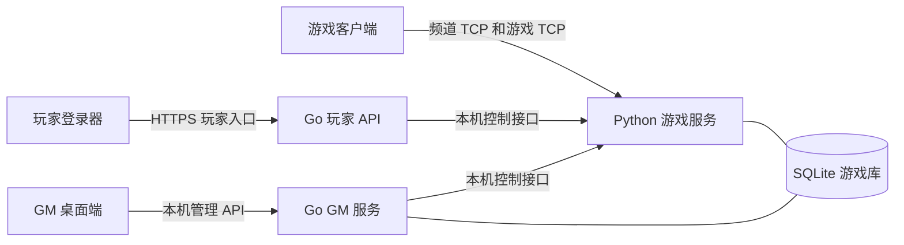

# 90USDFO 服务端源码

90USDFO 项目源码，包含游戏服务端、GM 管理后台、玩家登录器和组队中继。

[搭建与联网](#搭建与联网) · [更新概要](#更新概要)

| 目录 | 内容 |
| --- | --- |
| `server_proto/` | Python 服务端、协议处理、玩法逻辑、SQLite 迁移和测试 |
| `server_proto/native_core/` | 服务端原生计算模块 |
| `server_proto/pvf/native/` | PVF 原生读取模块 |
| `server_proto/start/native_launcher/` | 本地会话启动辅助程序 |
| `gm_manager/` | Go GM 服务、桌面端、玩家登录器及下载器 |
| `player_launcher/` | WPF 登录器、原生启动程序及辅助桥接 |
| `party_relay/` | Go 组队中继和边缘节点服务 |
| `server-pack-win10/` | Windows 运行目录和启动相关辅助源码 |

[GM 后台与登录器构建及本地配置](player_launcher/README.md)。

## 搭建与联网

以下以 Windows x64 同一台机器运行 Python 游戏服务和 Go 后台为例。先从本机连通，再改局域网或公网地址。PowerShell 示例中的地址、目录及端口按自己的环境填写。



### 1. 准备运行环境与配套文件

| 项目 | 所需内容 |
| --- | --- |
| 游戏服务器 | Windows x64、CPython **3.12.10 x64**、源码及匹配的原生 PVF 模块 |
| GM 后台与组队中继 | Go 1.26，按 [构建与本地配置](player_launcher/README.md) 编译。构建 WPF 登录器另需 .NET 8 SDK，运行时使用配套的 .NET 6.0.36 Windows x86。 |
| 游戏与大厅 | 自行准备同一版本的客户端、`DFO.exe`、服务端和玩家端各自配套的 `Script.pvf`、扩展和原生启动组件 |
| 游戏存档 | 自己的零玩家初始化 SQLite 库，或经备份和迁移核验的兼容库。Go 玩家服务需要账号、角色、钱包、GM 表及有效的钱包迁移记录。 |
| 玩家 HTTPS | 自己签发或取得的 **RSA 2048 位以上**证书与私钥。证书 SAN 匹配登录器填写的主机名或 IP。 |

公开库提供源码。完整启动还依赖游戏文件、初始化数据及配套保护构建输入。服务端首次启动自动建库会查找同版本分享版 `server-pack-win10/resources/` 下的 `schema_inventory_full.sql` 和 `default_inventory_seed.sql`，当前公开源码树仅附有迁移补丁。直接创建空 SQLite 文件无法满足 Go 玩家入口的库结构校验。应先准备兼容空库并在其副本上试装。

服务端 `usdof_pvf_native.cp312-win_amd64.pyd` 必须位于 `server_proto`。推荐同时构建同目录的 `usdof_core.cp312-win_amd64.pyd`。编译时按 [PVF 模块](server_proto/pvf/native/README.md) 和 [原生计算模块](server_proto/native_core/README.md) 准备 CPython 头文件、`python312.lib` 和 x64 LLVM-MinGW。现有脚本从仓库相对路径 `server-pack-win10/cache/python-3.12.10-full` 和 `analysis_output/toolchains/llvm-mingw-20260616-msvcrt-x86_64` 查找这些依赖。在开发副本根目录运行下列命令。

```powershell
pwsh -File .\server_proto\pvf\native\build_with_llvm_mingw.ps1 -Verify
pwsh -File .\server_proto\native_core\build_with_llvm_mingw.ps1 -Verify
```

### 2. 启动 Python 频道、游戏和本机控制接口

在仓库根目录准备下列示例布局，将变量指向自己准备好的文件。让 `python` 指向 3.12.10 x64 或显式使用该版本的 `python.exe`。

```powershell
$repo = (Get-Location).Path
$runtime = Join-Path $repo 'runtime'
$env:USDOF_CLIENT_DIR = Join-Path $runtime 'client'
$env:USDOF_PVF_PATH = Join-Path $runtime 'server\Script.pvf'
$env:USDOF_SQLITE_DB = Join-Path $runtime 'db\game.sqlite3'

python -B .\server_proto\start.py --host 127.0.0.1 --advertise-host 127.0.0.1 --channel-port 7001 --game-port 10052 --control-host 127.0.0.1 --control-port 17600 --login-host 127.0.0.1 --db-path $env:USDOF_SQLITE_DB
```

- `--host` 是频道和游戏套接字的绑定地址，`--advertise-host` 是供客户端连接的 IPv4。只在同一台电脑测试时，两者可用 `127.0.0.1`。
- 成功后检查频道及游戏日志到达就绪状态，并核对 `server_proto/log/control_endpoint.json` 已生成。此文件包含内部令牌，Go 后台在本机使用该文件。
- 启用完整登录流程时保持组合启动。当前 Python 的 Login 对象管理内部会话而不对玩家提供外部 HTTP 入口，玩家请求由下一步的 Go HTTPS 服务转到本机控制接口。无需转发兼容参数 `17602`。

### 3. 启动 Go 后台与玩家 HTTPS

在另一个 PowerShell 7 终端进入同一仓库。先构建 `gmserver.exe`，再用 `-init` 生成配置和随机令牌。已有配置直接编辑，`-init` 会拒绝覆盖。示例先使用本机地址测试，`17443` 是自选的玩家 HTTPS 端口。

```powershell
$repo = (Get-Location).Path
$runtime = Join-Path $repo 'runtime'
$private = Join-Path $runtime 'private'
New-Item -ItemType Directory -Force $private,(Join-Path $repo 'build') | Out-Null
Push-Location gm_manager
go build -o ..\build\gmserver.exe ./cmd/gmserver
Pop-Location

$cfg = Join-Path $private 'go-manager.json'
$gm = Join-Path $repo 'build\gmserver.exe'
if (!(Test-Path -LiteralPath $cfg)) { & $gm -init -config $cfg }

$config = Get-Content -LiteralPath $cfg -Raw | ConvertFrom-Json -AsHashtable
$config.listen = '127.0.0.1:17890'
$config.server_root = $repo
$config.game_database = Join-Path $runtime 'db\game.sqlite3'
$config.control_endpoint_file = Join-Path $repo 'server_proto\log\control_endpoint.json'
$config.direct_database = $true
$config.launcher_listen = '127.0.0.1:17443'
$config.launcher_public_host = '127.0.0.1'
$config.launcher_certificate = Join-Path $private 'player-cert.pem'
$config.launcher_key = Join-Path $private 'player-key.pem'
$config | ConvertTo-Json -Depth 8 | Set-Content -LiteralPath $cfg -Encoding utf8NoBOM

```

将匹配的证书与私钥放到上面指定的位置。若已安装 OpenSSL，可在同一终端用以下命令生成只用于本机验证的证书。部署到局域网或公网时，使用 SAN 与实际登录地址匹配的证书。

```powershell
openssl req -x509 -newkey rsa:2048 -sha256 -days 30 -nodes -keyout $config.launcher_key -out $config.launcher_certificate -subj '/CN=127.0.0.1' -addext 'subjectAltName=IP:127.0.0.1'
```

准备好证书后启动 Go 服务。

```powershell
& $gm -config $cfg
```

在另一个终端用 `Invoke-RestMethod http://127.0.0.1:17890/health` 检查 Go 管理入口。GM 桌面端「连接／验证」填写 `http://127.0.0.1:17890` 和初始化配置里的管理令牌。私钥、管理令牌和 `control_endpoint.json` 只保存在服务器或管理员本机。

已有库如果被报「旧版福利／注册奖励或计划任务待迁移」，先处理未发奖励和规则，再切换到 Go 玩家入口。需要 Go 后台执行计划任务时，经同一备份与规则核对后设置 `enable_jobs`。

### 4. 生成玩家登录器并准备更新资源

1. 按 [登录器构建说明](player_launcher/README.md) 准备同一架构的登录器、启动组件、辅助桥接和 .NET 运行库。GM 当前「生成本机登陆器」使用带保护的原版模板，模板清单在 GM 目录的 `登录器模板/清单.json`。模板 EXE 需有同目录的 `保护证明.json`、一致的运行库清单及运行库。普通 `dotnet build` 只生成可编译的开发版。
2. 在 GM 的「登录下载管理」中填名称、服务器标识、玩家 HTTPS 地址和对应的公开 PEM 证书。仅本机联调用 `https://127.0.0.1:17443`。地址格式为 `https://主机:端口`，主机要与证书匹配。生成后将 EXE、`Image` 和 `runtime` 等客户端配套目录一起交付。
3. 需要自动更新时，在 GM 的 PVF 版本管理中登记并启用与当前服务端配套的玩家 PVF、校验值、必要的本地钥集和玩家可访问的更新链接。使用 Go 自带的资源下载入口时，资源包位于 `server_proto/resources/launcher/<玩家PVF的SHA256>.zip`，给玩家的地址为 `/launcher/v1/resources/current.zip`。服务端登记的活动版本、客户端下载清单和客户端真实文件要一致。相关素材和签名由部署者自己的发布流程准备。
4. 在 GM 核对注册开关和注册规则，用登录器创建测试账号。若启用注册码规则，先在 GM 制码。用首个账号登录、进入频道和角色页、建角色、进城，再验证普通副本。

### 5. 局域网和公网

| 入口 | 默认或示例值 | 联网配置 |
| --- | --- | --- |
| 玩家 HTTPS | TCP 17443（示例） | Go `launcher_listen` 绑定面向玩家的网卡或 `0.0.0.0`，开放实际使用的 TCP 端口 |
| 频道 | TCP 7001 | Python `--host` 绑定实际网卡或 `0.0.0.0`，开放频道实际端口 |
| 游戏 | TCP 10052 | 放行 `/launcher/v1/meta` 返回的 `stage3.game_ports` 和所用频道实际宣告的游戏端口，多频道或旧客户端可能增加端口 |
| 额外连接 | 默认 TCP 10128、17101、17200，UDP 12311、12312 | 按客户端版本及实际启动日志放行已用端口，区分 TCP 和 UDP |
| Python 控制与 GM 管理 | TCP 17600、17890 | 保持本机绑定；GM 远程管理使用独立专网和 TLS |

局域网把 `--advertise-host` 及 `launcher_public_host` 设置成这台主机的局域网 IPv4，把玩家登录器的 HTTPS 地址改成可访问且证书匹配的地址。两台电脑分别测试，外部玩家连接时不能使用 `127.0.0.1`。

公网把这两处宣告的 IPv4 设置成玩家实际可达的入站公网 IPv4。云主机按上表开放 Windows 防火墙及云安全组。家庭网关先给服务器固定内网地址，再把实际使用的 TCP／UDP 端口逐个转发到同一台服务器。没有可入站的公网 IPv4 时，可将服务器和客户端放到同一可路由的 VPN 网络，并统一使用 VPN IPv4 作宣告地址。内网玩家如果使用公网地址，路由器须支持回流转发。玩家入口校验原始连接及 TLS，部署时优先直接转发 TCP 到 Go 的 HTTPS 端口。

从玩家所在的另一台电脑验证。将以下文档示例地址换成自己的实际值，HTTPS 校验遇到自建 CA 时用 `--cacert <公开证书或 CA 文件>` 指定信任材料。

```powershell
Test-NetConnection '192.168.1.50' -Port 7001
Test-NetConnection '192.168.1.50' -Port 10052
Test-NetConnection 'game.example.test' -Port 17443
curl.exe --fail --show-error --cacert .\player-cert.pem https://game.example.test:17443/launcher/v1/meta
```

`/launcher/v1/meta` 应返回游戏连接资料及 `stage3`。HTTPS 可访问却进不了频道时，优先核对返回的 IPv4、`channel_port`、`game_ports`、端口转发、客户端与 PVF 配对。TCP 通测通过后仍要完成实际登录、选角和普通副本。UDP 连通及跨网组队以双方互见、共同进图、过门和结算为准。

### 6. 可选的跨网组队中继

先完成基础登录链路，再为有配套边缘组件的测试玩家启用中继。进入 `party_relay` 构建 `party_relay.exe`，服务端用 `-mode relay -config <中继本地配置>` 启动。服务端 JSON 填 `listen`、`tls_certificate`、`tls_private_key`、`control_key_file`。启用 UDP 转发时同时填 `udp_listen` 和玩家可达的 `udp_public`。控制密钥文件为部署者生成的 **32 字节二进制文件**。

Python 进程启动前设置 `USDOF_PARTY_RELAY_CONFIG` 走独立 JSON，字段为 HTTPS 的 `control_url` 和 `public_url`、`ca_file` 与 `key_file`。两端控制密钥同源，公开地址与 TLS 证书匹配。可用 `rollout_accounts` 指定测试账号 ID，留存试点时同队角色须使用一致的连接模式。玩家侧由配套登录器启动 `-mode edge` 并交接授权，分发包只带边缘程序及公开信任材料。中继和 UDP 端口按实际设置开放后，用不同网络下的两名玩家验证。

## 本地检查

Python 服务端的受支持环境为 Windows x64 和 CPython 3.12.10 x64。以下测试可用本地临时数据运行。

```powershell
Push-Location server_proto
$env:USDOF_NATIVE_CORE = 'off'
python -B -m unittest discover -s tests -p 'test_connection_repairs.py'
python -B -m unittest discover -s tests -p 'test_udp_effective_address.py'
Pop-Location
```

完整的 Python 联调另外依赖配套客户端、PVF 以及部分历史组队和团本测试夹具。本快照的选角回包联调还有四个已知失败用例。

GM 管理服务和组队中继是独立的 Go 模块，要求 Go 1.26。分别进入模块目录运行 `go test ./...`。

```powershell
Push-Location gm_manager
go build -o ..\build\gmserver.exe ./cmd/gmserver
Pop-Location

Push-Location party_relay
go build -o ..\build\party_relay.exe .
Pop-Location
```

## 更新概要

- 修复安徒恩、卢克团本的编队、进图、过门、重连、战况表和翻牌结算。
- 调整团本门票限购及材料扣除，修复部分任务完成条件、副本地图和材料掉落。
- 更新佣兵出战天数与奖励、永久装扮券、稀有克隆礼盒和部分装备属性。
- 修复改名卡、玩家交易和仓库整理，支持在线角色的点券余额刷新。
- GM 后台支持定时在线福利、普通 CDK 手动制码和游戏内 Coupon 兑换。
- 更新登录器、游戏内辅助和组队中继，改善客户端配对检查与联网兼容。

## 许可证

项目许可证待定。Go 第三方依赖见各模块的 `go.mod`，其各自的许可证继续适用。
